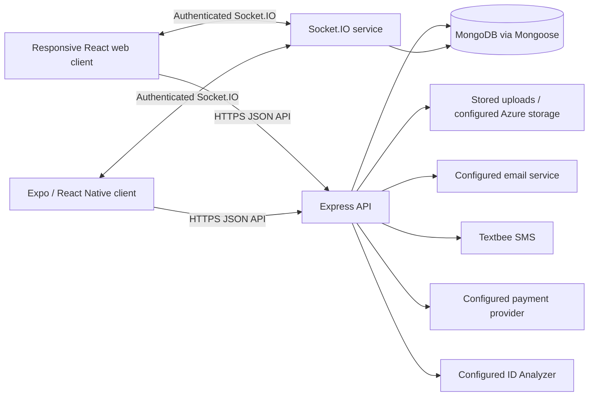
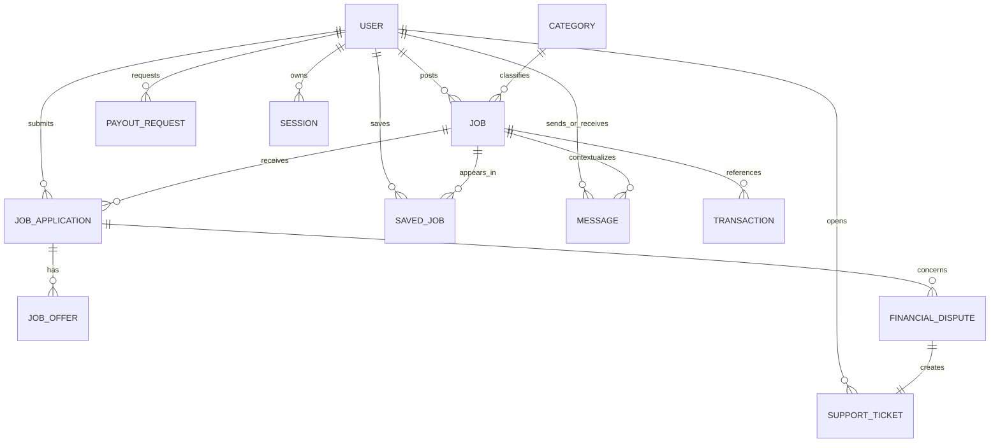
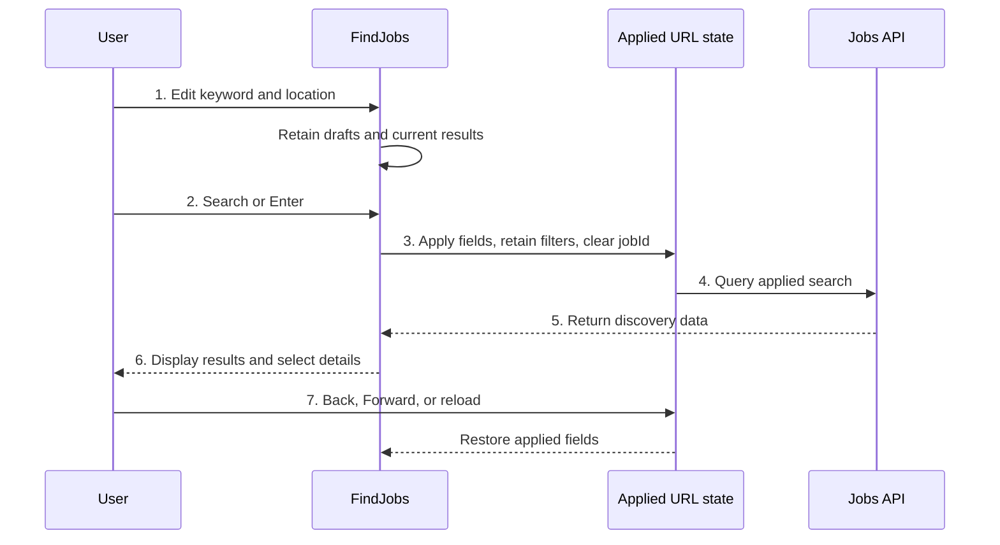
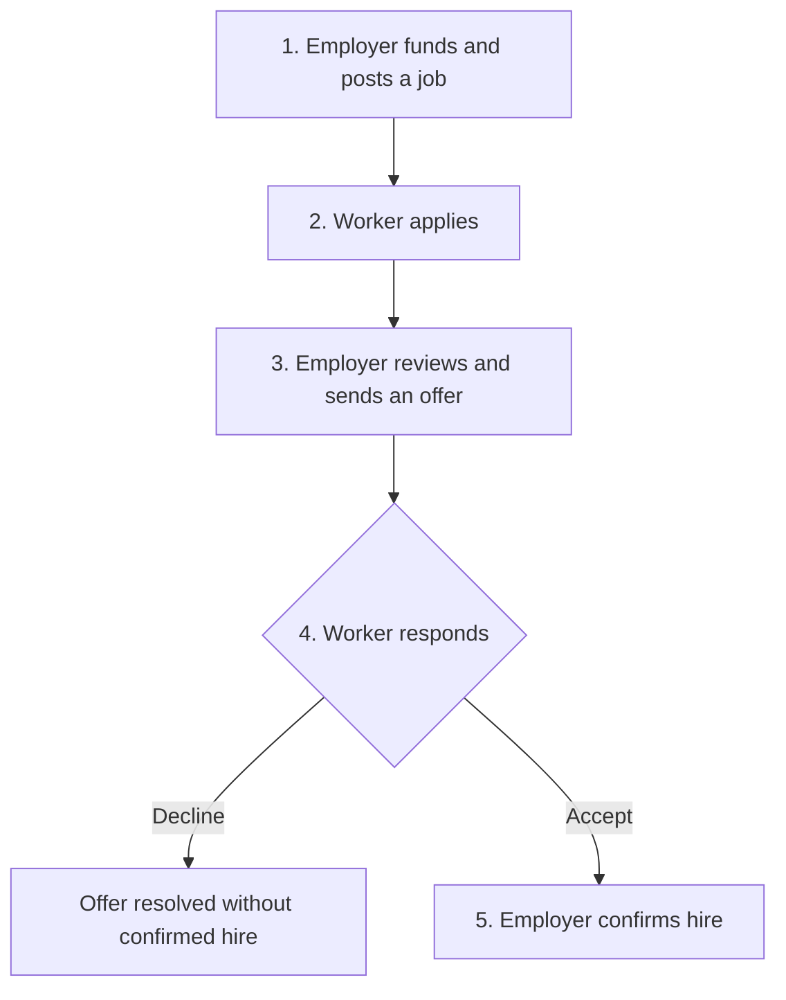
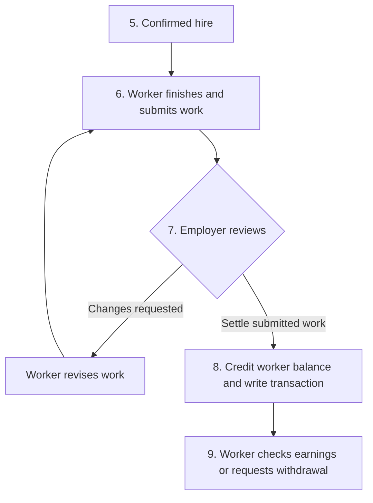

# MicroJobs System Specification

**Document version:** 1.2
**Prepared:** 13 October 2026  
**Basis:** the current repository implementation, including the financial-dispute investigation and settlement workflow
**Audience:** developers, testers, maintainers, and project reviewers

## Contents

1. [Purpose and scope](#1-purpose-and-scope)
2. [Actors and access control](#2-actors-and-access-control)
3. [Architecture and technology](#3-architecture-and-technology)
4. [Functional requirements](#4-functional-requirements)
5. [Search and recommendation specification](#5-search-and-recommendation-specification)
6. [Hiring and financial business rules](#6-hiring-and-financial-business-rules)
7. [Data specification](#7-data-specification)
8. [Interface specification](#8-interface-specification)
9. [Security and quality requirements](#9-security-and-quality-requirements)
10. [Runtime and deployment](#10-runtime-and-deployment)
11. [Verification and acceptance](#11-verification-and-acceptance)
12. [Limitations and implementation references](#12-limitations-and-implementation-references)
13. [Interface designs and numbered walkthroughs](#13-interface-designs-and-numbered-walkthroughs)
14. [Workflow designs](#14-workflow-designs)

## 1. Purpose and scope

MicroJobs is a Philippine employment marketplace supporting public job discovery, worker profiles and applications, employer job posting and hiring, messaging, funded job payments, wallets, verification, support, and administrative operations.

The system consists of a responsive web application, a separate native mobile application, and a shared API backed by MongoDB. The detailed user-interface behavior in this document concerns the current web application. Native mobile screens retain separate layouts and must be tested independently.

This is an implementation-based specification. It distinguishes existing behavior from operational targets that have not been measured. It does not assert production availability, a security certification, a service-level agreement, or complete web/mobile feature parity.

### Included capabilities

- Registration, verification, sign-in, recovery, session management, and account settings.
- Worker and employer account views, including accounts supporting both roles.
- Nationwide job search, location selection, filters, saved jobs, and profile-based recommendations.
- Job posting, applications, interviews, offers, hiring, and per-worker completion/payment.
- Messages, notifications, reviews, support tickets, wallets, and payout requests.
- Permission-based staff administration, finance, verification review, moderation, and analytics.

Application-managed database backup and restore is not implemented. No new remote-work field or database migration is required by the recent web search redesign.

## 2. Actors and access control

| Actor | Access boundary |
| --- | --- |
| Visitor | Landing page, public job list/details, authentication pages, and legal documents. |
| Worker (`work`) | Protected worker pages, own applications, saved jobs, profile, messages, worker wallet, settings, notifications, and support. |
| Employer (`hire`) | Employer pages, owned listings and applications, offers, employer wallet, profile, messages, settings, and support. |
| Dual-role user (`both`) | Worker and employer capabilities through the selected account view. |
| Staff (`admin`) | Administrative actions granted by `staffRole`. |
| Superadmin (`superadmin`) | Highest administrative authority under the server permission model. |

Staff roles are `admin_team`, `moderator`, `finance_team`, `analytics_team`, and `support_staff`. Server-side authorization is authoritative; hiding a menu item is not the access-control boundary. Ownership checks govern access to applications, job mutations, payments, and conversations.

Staff role permissions are maintained in corresponding client and server matrices. Changes must keep those matrices consistent. Legacy route names redirect to current worker, employer, or admin routes; they do not represent additional business roles.

## 3. Architecture and technology



The client presents role-specific pages and calls the API. The API performs validation, authentication, authorization, business operations, persistence, and integration calls. Socket.IO supports authenticated real-time delivery. Models and services handle related financial and workflow records.

| Area | Current technology or responsibility |
| --- | --- |
| Web | React 19, TypeScript, Vite 7, React Router 7, Tailwind CSS 3, Motion, React Query, and i18next. |
| API | Node.js, Express 5, Mongoose 9, JSON routes, and multipart uploads. |
| Persistence | MongoDB collections with ObjectId relationships, indexes, and transactions for critical financial flows. |
| Real-time | Socket.IO 4 with session-authenticated connections. |
| Native mobile | Expo and React Native with React Navigation; versions follow the current mobile manifest. |
| Authentication | JWT access tokens, persisted sessions, rotating refresh sessions, bcrypt password hashing, OTP, and available MFA. |
| Integrations | Email, Textbee phone verification, ID Analyzer, payment checkout/webhooks, and configured storage. |
| Testing | TypeScript checks, ESLint, locale checks, Node server tests, and Playwright browser tests with Axe checks. |

### Main repository areas

- `client/src`: web components, pages, services, hooks, localization, and routing.
- `server/routes`: HTTP route registration and endpoint access middleware.
- `server/controllers`: request handlers and workflow entry points.
- `server/models`: Mongoose data definitions and indexes.
- `server/lib` and `server/services`: shared business rules, integrations, and settlement logic.
- `Mobile`: native mobile client and its own navigation/configuration.
- `tests/e2e`: browser workflow, accessibility, and responsive tests.

## 4. Functional requirements

The following requirements describe implemented capabilities. An action may remain unavailable until the user's role, record state, profile requirements, or external service configuration permits it.

| ID | Requirement |
| --- | --- |
| FR-01 | Register worker, employer, or dual-role accounts, validate required inputs, and support the configured email verification flow. |
| FR-02 | Authenticate users through supported password/Google flows and complete required OTP or enabled MFA challenges. |
| FR-03 | Support password recovery, password changes, session revocation, and trusted-device management through protected interfaces. |
| FR-04 | Let users manage their profile photo, contact/location information, skills, experience, résumé, internships, certificates, and matching preferences. |
| FR-05 | Track email, phone, identity-document, and address-document verification. Display the verified seal only when all four checks are complete. |
| FR-06 | Provide a public job-search page and a protected worker job-search page using the common FindJobs interface. |
| FR-07 | Apply keyword and location drafts together only on Search/Enter, preserve filters, clear the selected job, and restore applied searches through URL navigation. |
| FR-08 | Default location to nationwide, support city/province suggestions and free text, and require submission after clearing the location. |
| FR-09 | Preserve pay, type, category, listing-time, few-applicant filters, active counts, sorting, and filter-reset behavior. |
| FR-10 | Save/remove jobs for authenticated workers and return signed-out Saved Jobs users through sign-in to the saved-jobs destination. |
| FR-11 | Provide independently ranked recommendations using profile and preference information, including a profile-completion state for all-zero matches. |
| FR-12 | Require an employer profile photo and sufficient funds when creating a listing; secure worker pay separately from posting/highlight fees. |
| FR-13 | Record applications uniquely per worker/job, require a worker profile photo, prevent own-job applications, and track application states and interviews. |
| FR-14 | Support offers, responses, cancellation, reserved positions, and employer confirmation of an accepted offer. |
| FR-15 | Track each hired worker's work and payment states; support submission, changes requested, authorization, and settlement. |
| FR-16 | Maintain employer/worker balances, top-up transactions, withdrawal requests, financial references, and supported receipt/QR settlement actions. |
| FR-17 | Provide participant-authorized conversations, job inquiry threads, offer/payment attachments, read state, blocking, archiving, and personal conversation deletion. |
| FR-18 | Let users open another participant's profile through an ordinary conversation header; exclude staff support participants from that shortcut. |
| FR-19 | Provide notifications, eligible reviews, support tickets, replies, and staff-only internal support notes. |
| FR-20 | Provide administrative queues and actions subject to staff permissions, with audit and finance records where applicable. |
| FR-21 | On signed-in Find Jobs, hide the top dashboard navbar and provide a usable navigation opener when needed. |
| FR-22 | Allow the desktop sidebar to slide away fully, persist its state, reopen it, and transfer keyboard focus appropriately. |
| FR-23 | Display the three informational profile/matching/verification cards on the landing page after its jobs section, with a responsive arrangement. |
| FR-24 | Provide English and Filipino interface labels, accessible inputs, keyboard-operable controls, and clear loading/error/empty states. |
| FR-25 | Provide worker-initiated financial disputes with automatic Support tickets, neutral notices, append-only evidence, Support investigation reports, exactly three Finance outcomes, independent Finance approval, idempotent ledger processing, participant-visible results, and an immutable case audit trail. |

## 5. Search and recommendation specification

### 5.1 Search state and URL contract

Keyword and location inputs have local draft state distinct from applied URL state. Search submission trims and applies both fields in a single URL update, preserves unrelated filter parameters, and removes the selected job ID. A subsequent result can then become the selected detail-pane job.

| URL parameter | Meaning |
| --- | --- |
| `q` | Applied keyword text. |
| `location` | Applied city/province/free text, or `nationwide` for a submitted nationwide search. |
| `category` | Selected category identifier. |
| `type` | Comma-separated client job-type selections. |
| `datePosted` | Listing period: `24h`, `week`, or `month`. |
| `minPay` | Minimum pay threshold. |
| `fewApplicants` | `1` enables the fewer-than-ten-applicants filter. |
| `jobId` | Selected result for the desktop detail pane. |

Reload and browser Back/Forward synchronize drafts with the restored applied search. Ordinary filter changes preserve unsubmitted keyword/location text. **Clear all** removes filter selections while retaining the search fields. Matching preferences are profile data rather than an additional results-filter count.

### 5.2 Filtering and ordering

- The job API accepts `search`, `location`, `category`, `jobType`, and the supported ownership exclusion parameter.
- An explicit location other than `nationwide` performs an escaped, case-insensitive substring match against the stored location text.
- API keyword matching searches title, description, and location. The FindJobs client additionally checks its title/company/category display text. The effective search is constrained by both stages; it is not semantic search across an unrestricted skill index.
- Pay, listing-age, few-applicant, and remaining display filters operate on the retrieved client results. The `24h` implementation uses floored age in days, not an exact rolling timestamp interval.
- Without an explicit location restriction, discovery is nationwide. A signed-in worker's home city/province may still influence ranking within the national result set.
- Discovery tiers place highlighted jobs first, then fully verified employers where worker priority applies, then normal jobs. Proximity and recency rank jobs within those tiers. Client sorting preserves discovery priority before its secondary sort.
- City/province suggestions depend on the Philippine geographic data source. Free-text entry remains available.

### 5.3 Recommendations

Recommendations use a separate authenticated query and do not inherit the search-filter pills. Eligible candidates are available, unexpired jobs excluding the viewer's own jobs and previously applied jobs. The controller evaluates up to 100 candidates ordered by urgency and recency before returning its requested bounded result count.

The matching function normalizes and tokenizes profile/job text. It produces a bounded 0–100 score:

| Component | Maximum score |
| --- | ---: |
| Category preference or category fit | 30 |
| Skills and requirements match | 40 |
| Relevant experience | 15 |
| Profile and preference text | 10 |
| Location match | 5 |

Match labels are **Excellent** at 80+, **Strong** at 60+, **Good** at 40+, and **Potential** below 40. Final recommendation ordering is score, urgency, and recency. Location contributes to the score; the controller's final comparator does not add a separate proximity tie-break.

The score is a deterministic heuristic, not a machine-learning prediction or probability of being hired. All-zero results prompt profile completion. A failed recommendation request must not prevent the main job search from functioning.

### 5.4 Responsive search interface

| Viewport | Control arrangement |
| --- | --- |
| Desktop, 1280px and above | Keyword, location, Search, and Saved Jobs in one row. |
| Tablet | Two input columns with the actions below. |
| Phone | Inputs stacked; Search and Saved Jobs remain together. |

The search band uses the MicroJobs blue palette, a compact **Job search** heading, white fields, a white Search button with blue text, and a pale-blue saved-jobs heart. Filters appear in the band in this order: Pay, Job type, Category, Listing time, Few applicants, and Matching preferences.

`FilterPill` supports an optional inverse appearance while retaining its ordinary appearance elsewhere. Menus remain white and may extend beyond the band without clipping.

## 6. Hiring and financial business rules

### 6.1 Listings and funding

New listing types are `Short-term`, `Side hustle`, and `Recruiting`; legacy types are retained by the data model. A listing records a positive pay amount, valid category, required title/description/location/type/deadline, and a positive integer number of positions.

The current listing cost rule is:

```text
secured worker pay = salary per worker × positions needed
posting fee        = PHP 20
highlight fee      = PHP 50 when highlighted, otherwise PHP 0
total debit        = secured worker pay + posting fee + highlight fee
```

Fees are separate from worker pay and non-refundable. A dual-role user can fund posting from the balances allowed by the posting service. Financial mutations use transaction-aware, guarded balance updates to prevent partial writes and concurrent overspending.

### 6.2 Capacity, applications, and offers

- One application record is allowed per job/applicant pair.
- A user cannot apply to their own listing.
- Worker application and employer posting completeness checks currently require a profile photo; they do not require the fully verified badge.
- Application stages are `Applied`, `Shortlisted`, `Interview Scheduled`, `Interviewed`, `Offer Sent`, `Hired`, `Rejected`, and `Withdrawn`.
- Offer states are `pending`, `accepted`, `rejected`, `cancelled`, and `hired`.
- An accepted offer requires employer confirmation to complete hiring.
- Confirming an offer hire sets the job to `In Progress`, regardless of remaining positions, and persists `hireConfirmedAt` as a permanent employer deletion lock. Web confirmation highlights the deletion restriction. The API rejects employer deletion of in-progress jobs or any job with a confirmed/current/legacy hire; administrator job-management authority retains its existing removal capability. Deletion, escrow refund, and dependent-record cleanup execute in one MongoDB transaction, preventing concurrent hire/delete success.
- Hired positions and reserved offers affect remaining capacity. A manually closed listing must not reopen merely because capacity changes.
- Job progress and recruitment availability are independent: an In Progress posting remains discoverable and accepts applications while it has unreserved positions, an unexpired deadline, and no manual closure, archive, or pending cancellation. Public/owned responses include `recruitmentOpen` and `availablePositions`. Offers still reserve capacity immediately; confirmed hires preserve In Progress regardless of capacity. Web/mobile posting actions display recruitment state and support closing/reopening remaining funded vacancies. Before-start cancellations reopen funded vacancies without resetting other workers' progress.
- Higher negotiated pay may require additional secured funds. Related cancellation/refund rules must use the offer and financial records.

### 6.3 Work and settlement

Hire confirmation optionally accepts a worker-specific checklist. Web and mobile Applications and chat confirmation provide a row editor; employer Job Management details provide persisted completion marks for each hired worker. The worker's chat renders only task descriptions in a table. Checklist marks are advisory employer tracking and are never a prerequisite for job transitions, evidence submission, completion, or settlement. See [Hire checklists](HIRE_CHECKLISTS.md) for the API, authorization, validation, and transaction contract.

Web/mobile workers can also read the full job description and their checklist in Applied Jobs → Assignment details. The participant-scoped `GET /api/applications/:applicationId/lifecycle` includes `job.description` and `application.hireChecklist`; the panel displays descriptions without interactive checkboxes and handles absent descriptions/checklists explicitly.

Worker application cards group Assignment details, green Submit proof, eligible Open payment dispute, and View details in one horizontally scrollable action row. Assignment details uses white with black text/border. Inside it Start work uses green and Request cancellation uses red; financial-dispute controls retain their existing styling and eligibility. Proof upload confirmation and sent chat status use consistent proof wording without changing submission validation or settlement behavior.

| Record field | Permitted states |
| --- | --- |
| Job status | Available, In Progress, Completed, Cancelled, Closed, Full refund, Resolved |
| Application work status | In Progress, Submitted, Changes Requested, Completed |
| Application payment status | Secured, Authorized, Processing, Disputed, Paid, Partially Paid, Refunded, Outstanding, Failed |
| Transaction status | PENDING, COMPLETED, FAILED, CANCELLED |
| Withdrawal request status | requested, approved, rejected, paid, cancelled |

Work submission is available to the hired worker from In Progress or Changes Requested. Settlement requires submitted work, the owning employer, and sufficient remaining job escrow. It credits the worker balance, writes a linked payout transaction, and marks that application completed/paid atomically.

Completion now requires 1–10 JPG, PNG, GIF, or WEBP images, up to 5 MB each, with an optional description. Images use the API-only `AZURE_EVIDENCE_CONNECTION_STRING` and `AZURE_EVIDENCE_CONTAINER_NAME` settings and an existing private Azure container. A successful submission sends the images to the owning employer's job chat with a green **Mark the job as done?** button. Confirmation states that funds will be released to the worker and invokes the existing guarded settlement; older revision cards cannot approve newer evidence. Participant/staff-authorized `/uploads` reads keep the blobs private. Financial-dispute document uploads and legacy completion files retain their existing support. See [Completion images and employer approval](COMPLETION_EVIDENCE.md) for the full contract.

The service uses a unique application payout reference and recognizes repeat settlement requests. The ordinary per-worker path can complete the job when every required hired position is completed and paid. Job-level completion and cancellation handlers also have their own settlement/refund logic and must remain covered by financial tests.

An employer may finish a partially filled posting by closing recruitment after all hired assignments are completed/paid, or by using Mark done after all hired workers submit. Mark done closes remaining recruitment within the payment transaction and rejects unresolved pending/accepted offers. Completion returns remaining escrow once through the existing original-wallet refund guard. Legacy hired Available/Closed posting phases are reported by the default dry-run lifecycle migration and repaired only with its explicit `--apply` option; migration never invents worker start dates or repairs ambiguous financial sources.

The web employer Job History page (`/employer/job-history`) reads authenticated, owner-scoped `GET /api/jobs/history`. Each owned listing includes title, status, `amountHeld`, and `amountPaid`. Amounts derive only from completed ledger records: held = max(0, escrow − payouts − refunds), paid = payouts. Posting/highlight fees and pending/failed transactions are excluded. View details reuses Applications Management cards scoped to the selected job's hired applications, including hidden applications, payment actions, and the existing completion-gated, duplicate-protected worker-review flow. `GET /api/jobs/mine` exposes owner-only `canDelete` for the deletion control.

### 6.4 Top-ups and withdrawals

Top-ups use provider references and validated confirmation/webhook data before crediting a balance. The PayMongo webhook verifies the signature against the preserved raw request bytes. Provider configuration and checkout availability are deployment-dependent.

Withdrawal requests record the selected balance target and a destination snapshot. Request creation deducts/reserves the amount and creates a linked transaction within a database transaction. Duplicate idempotency keys are constrained per user. Approval, rejection, payment, and cancellation are distinct operations with corresponding balance/transaction rules.

All documented listing examples use Philippine pesos. External payout processing time is not specified by this repository.

### 6.5 Financial dispute investigation and settlement

A hired worker with submitted work and a pending payment may open one active financial dispute for the application. Submission atomically marks the application `Disputed`, creates a `FIN-YYYY-*` dispute record, creates and links a high-priority Support ticket, records the first audit entries, and sends neutral investigation notices to the worker, employer, and authorized Support staff. An employer may respond and submit evidence but cannot open the worker's claim, reject it, select a settlement, or edit Finance findings.

Investigation state and payment state are deliberately separate. The former uses the case workflow (`UNDER_INVESTIGATION`, evidence-waiting/review states, `FOR_FINANCE_REVIEW`, `PENDING_FINANCE_APPROVAL`, processing, appeal, and `RESOLVED`); the latter states whether value is unpaid, partially paid, actually held, outstanding outside the platform, processing, paid, refunded, or settled. `FUNDS_HELD` represents only money controlled by the platform. `OUTSTANDING_PAYMENT` is an external obligation and is never displayed as escrow.

Support may assign an investigator, review linked job/application/payment records, request evidence, add private or participant-visible notes, and complete the structured Investigation Report. Support has no Finance proposal or approval permission. Finance cannot propose a result until that report is complete and forwarded. Finance selects exactly one outcome:

- `FULL_REFUND`: eligible held funds go to the employer; earlier worker payments are not reversed.
- `COMPLETE_PAYMENT`: only the remaining agreed amount is payable to the worker; previous payouts are deducted.
- `PARTIAL_PAYMENT`: Finance explicitly allocates the available disputed held funds between worker payment and employer refund.

After approval and verified settlement processing, the linked job becomes `Full refund` for Full Refund, `Completed` for Complete Payment, or `Resolved` for Partial Payment. This job update is part of the same database transaction. `Full refund` jobs are excluded from employer Job Management but retained in Job History. Both new final statuses are excluded from discovery and protected from ordinary status changes or reopening.

Every proposal requires a written reason. A different authorized Finance user must approve it. Approval rechecks the current ledger, writes unique settlement-specific payout/refund references inside one MongoDB transaction, updates wallet balances and the application, records payment verification or an explicit outstanding external obligation, resolves the linked Support ticket, notifies both parties, and closes the case. Repeated approval/processing calls return the completed result without duplicating credits or refunds. Either participant may submit one appeal after a decision; the original report and settlement move to immutable history, the ticket reopens, and the case returns through Support investigation and Finance review without reversing a completed ledger transfer.

## 7. Data specification

MongoDB is accessed through Mongoose. The following table lists logical records and representative fields; the model files are the authoritative complete field definitions.

| Record | Representative fields and relationships |
| --- | --- |
| User | Identity/contact fields, role/staff role, status, hashed password, profile data, preferences, verification, employerBalance, workerBalance. |
| Category | Job category identity and presentation data. |
| Job | Title, description, location, salary, type, deadline, category, jobPoster, positionsNeeded, hiredCount, reservedOfferCount, status, promotion fees. |
| JobApplication | Job, applicant, résumé/cover letter, status, interviews, timeline, agreed amount, work/payment states, timestamps. |
| JobOffer | Job, application, employer, worker, amount, additional escrow, state, and associated message. |
| SavedJob | User/job pair and save timestamps. |
| JobView | Viewer deduplication record supporting a listing's view count. |
| Message | Sender, receiver, optional job, content, offer/settlement attachment, read/edit state, client message ID, and per-user deletion. |
| Transaction | Sender/receiver, amount, type, status, balance target, job/request links, unique reference, provider reference, actor, and metadata. |
| PayoutRequest | User, amount, balance target, destination snapshot, review/payment state, reviewer, linked transaction, idempotency key. |
| QrSettlementRequest | Job/payment request context, invoice/QR details, and resolution state. |
| PaymentMethod | User-owned payment destination/method information and default selection. |
| Review | Eligible relationship-based feedback, ratings/content, and supported reactions/replies. |
| Notification / Alert | Recipient-specific events, read state, and related record context. |
| SupportTicket | Requester, subject/category/priority, status, public messages, staff-only internal notes, and timestamps. |
| FinancialDispute | Ticket/job/application/participant links; agreed, paid, disputed, held, and outstanding amounts; separate investigation/payment states; append-only evidence and messages; structured report; Finance settlement/approval; appeal; embedded audit history. |
| ModerationReport | Report subject, evidence/reason, status, and reviewer/resolution information. |
| Session / TrustedDevice | User/session ownership, active/expiry state, refresh-token data, and trusted-device state. |
| OtpChallenge / PhoneVerification / PendingIdScan | Temporary verification/recovery challenges and intermediate ID scan data. |
| AuditLog | Administrative or sensitive-action audit metadata. |
| StoredUpload / PushDevice / RateLimitBucket | File persistence, mobile notification registration, and supporting request-limiting state. |

### Core relationships



This is a logical relationship diagram; MongoDB does not enforce relational foreign keys. Optional references and ownership rules are validated by application code.

### Important integrity constraints

- Unique user email and relevant sparse account identifiers.
- Unique application `(job, applicant)` and saved-job `(user, job)` pairs.
- Unique transaction references where present.
- Unique withdrawal `(user, idempotencyKey)` values where present.
- Unique sent-message `(sender, clientMessageId)` values where present.
- Deduplicated job-view records with a matching unique index.
- At most one active financial dispute per job application, plus unique settlement transaction references.
- Required model enums, amount constraints, and controller-side role/ownership checks.

## 8. Interface specification

### 8.1 Web routes

| Area | Representative routes |
| --- | --- |
| Public | `/`, `/jobs`, `/sign-in`, `/sign-up`, `/forgot-password`, `/legal` |
| Worker | `/worker/find-jobs`, `/worker/applied-jobs`, `/worker/saved-jobs`, `/worker/job-details/:jobId`, `/worker/financial-disputes`, `/worker/profile` |
| Employer | `/employer/dashboard`, `/employer/post-job`, `/employer/jobs`, `/employer/job-history`, `/employer/applications`, `/employer/financial-disputes`, `/employer/profile` |
| Shared role pages | Role-specific messages, wallet, settings, notifications, and support routes. |
| Profile viewing | `/profiles/:userId`, under the authenticated dashboard layout. |
| Administration | `/admin/dashboard`, `/admin/user-management`, `/admin/staff-management`, `/admin/verification`, `/admin/payouts`, `/admin/disputes`, and other permission-gated pages. |

Although profile viewing is described as a public-facing profile, its current route/API requires sign-in. Public job discovery is available without sign-in.

### 8.2 Employer Applications (web)

The employer Jobs Management page excludes `Completed` and `Full refund` postings from its displayed list. Completed jobs remain accessible in Job History; this web display filter does not remove records or change their stored state.

The web Employer Applications page is table-only. Its job selector reads owner-scoped `GET /api/jobs/history`, including listings with no applications and fully refunded jobs omitted from Job Management; the first returned job is selected initially. The page fetches applications for only the selected `jobId`, renders that job's title, and retains local search/stage filters, selection-based bulk actions, and hide/restore. Columns are Name, Stage (colored text badges), Interview (schedule/reschedule), Applied on, Resume (safe file link), View Profile, Actions, and Hide.

Actions opens an accessible, scrollable four-step dialog derived from persisted application/offer state: (1) Change Status and formal offer amount/confirmation; (2) applicant reviewing the pending offer; (3) accepted-offer hire decision with the highlighted in-progress/deletion warning and Hire/Reject; (4) hired application payment authorization and existing work/payment controls. Pending offers refresh every ten seconds while the dialog is open and the page is visible, and on window focus; refresh stops after a response or dialog closure. Declined offers return to step 1 with an explanation. Hire retains its existing confirmation and API; Reject confirms, cancels the offer through the existing refund/capacity path, then sets application status to Rejected. Payment authorization does not release funds; settlement and revision retain submitted-work/dispute guards. Messaging and completion-gated ratings remain in Actions. Job History retains its hired cards.

### 8.3 API groups

| Prefix / endpoint | Responsibility |
| --- | --- |
| `/api/auth` | Registration, login, OTP/MFA, recovery, refresh/logout, profile/settings, sessions, and verification status/actions. |
| `/api/jobs` | Public discovery/details, recommendations, owned listing operations, and applicant listing. |
| `/api/jobs/:jobId/apply` | Application submission. |
| `/api/applications` | Application retrieval/status, interviews, work submission, and payment actions. |
| `/api/job-offers` | Offer response, cancellation, and hire confirmation. |
| `/api/saved-jobs` | Saved-job retrieval and mutations. |
| `/api/messages` | Conversations, inquiries, messages, read/edit state, block/archive/delete operations. |
| `/api/payment` | Wallet/transactions, checkout, confirmation/webhook, payment methods, receipts, QR requests, and withdrawals. |
| `/api/notifications`, `/api/alerts` | User events and read state. |
| `/api/reviews` | Eligible reviews, profile review lists, reactions, and replies. |
| `/api/support` | Agents, own tickets, ticket details, and replies. |
| `/api/financial-disputes` | Participant-scoped case lists/details, append-only evidence, conversation, employer response, and appeal. |
| `/api/verify-id` | Configured identity scan/verification flow. |
| `/api/admin` | Staff-permission-based management, finance, review, analytics, and audit operations. |
| `/api/health`, `/api/ready` | Service health and readiness; readiness follows the database gate. |
| `/uploads` | Controlled uploaded-file retrieval. |

JSON is used for ordinary requests/responses; upload endpoints use multipart forms. Protected endpoints authenticate sessions. Public job routes use optional authentication. Exact payloads and error fields are defined by the current routes/controllers rather than a generated OpenAPI contract.

Common responses include validation errors, authentication failures, authorization failures, missing records, workflow conflicts, rate limits, and server errors. Production error handling hides stack/internal details and adds a request identifier to relevant server-error responses.

## 9. Security and quality requirements

### Implemented security controls

- Password hashing with bcrypt and server-validated authentication challenges.
- JWT validation combined with an active, unexpired persisted session and an active authoritative user record.
- Session ownership and server-derived role/staff-role checks rather than trusting client role selection.
- Cookie-based sessions with CSRF protection; an explicit bearer transport supports configured cross-host/native use cases.
- Refresh-session rotation, session revocation, trusted-device controls, login lockout, and rate limiting on sensitive operations.
- Exact configured production origins, HTTPS requirements, security headers, request sanitization, and production error redaction.
- Controlled file upload types/signature checks and access rules for sensitive files.
- Authenticated Socket.IO connections with session validation and configured connection limits.
- Participant/owner access checks and private support-note filtering.
- Financial transactions, unique references, guarded debits, and duplicate-operation protections in critical paths.

Security controls must be maintained and tested when routes, permission matrices, providers, or session transport change. This list is not a penetration-test result.

### Quality criteria

| Area | Acceptance criterion |
| --- | --- |
| Responsive interface | Search controls remain readable and inside the viewport at narrow-phone, tablet, and desktop widths. |
| Keyboard access | Inputs, filter menus, Search, saved-jobs, and navigation controls have labels and keyboard access; Escape closes appropriate menus/drawers and focus returns to a usable control. |
| Focus and contrast | Visible focus treatment and readable foreground/background combinations in the tested search and benefit-card regions. |
| Localization | English/Filipino keys remain structurally consistent and translated labels do not overflow tested controls. |
| Reliability | Loading, empty, error, and retry states are explicit; recommendation failure does not block the main result list. |
| Financial consistency | Concurrent/repeated requests must not produce negative guarded balances or duplicate completed settlement transactions. |
| Dispute separation of duties | Support cannot propose/process settlement; Finance cannot decide before a completed report; the proposer cannot approve; participants cannot mutate Finance records. |
| Maintainability | Web type checks, lint, locale checks, relevant server/browser tests, and the production build complete as appropriate for a change. |

No benchmark-derived maximum concurrency, response-time SLA, uptime guarantee, retention policy, backup schedule, or recovery objective is defined by the repository. Such operational targets require a separate deployment plan and measurement.

## 10. Runtime and deployment

### 10.1 Local setup

Use the repository-supported Node runtime: Node.js 22.13 LTS, or Node.js 24.3 or newer according to the project runtime guidance. Install dependencies from the repository root; `client/` intentionally has no separate package manifest.

```bash
npm ci
npm run dev
```

The unified development launcher starts or reuses the API, web app, and mobile development services. Default ports are API **5050**, web **8082**, and Expo Metro **8081**. Service-specific overrides are `DEV_API_PORT`, `DEV_CLIENT_PORT`, and `METRO_PORT`. Tunnel mode is available through `npm run dev:tunnel`.

Consult `client/.env.example` and `server/.env.example` for the configuration contract. Use placeholders when distributing setup instructions and keep actual secrets outside version control.

### 10.2 Required infrastructure

- Web hosting capable of serving the Vite build and routing SPA requests correctly.
- An API runtime suitable for the selected deployment model.
- Persistent MongoDB with transaction support, normally a replica set or managed equivalent.
- Configured mail delivery for the required verification/recovery flows.
- A reachable Socket.IO deployment for real-time delivery.
- Configured payment, SMS, ID verification, and storage services for the features enabled in that deployment.

The local in-memory MongoDB replica set is a development/testing fallback. It is not persistent production storage. Production requires an explicit database configuration and passes runtime validation before serving normal data requests.

### 10.3 Configuration groups

| Group | Representative environment settings |
| --- | --- |
| Database | `MONGO_URI`, database-name configuration. |
| Authentication | `JWT_SECRET`, cookie domain/transport settings, CSRF/session-related configuration. |
| Origins/proxy | `WEB_ORIGIN`, `CLIENT_ORIGIN` or supported frontend origin settings, `TRUST_PROXY`. |
| Web API | `VITE_API_BASE`, optional `VITE_SOCKET_URL`, optional `VITE_AUTH_TRANSPORT`. |
| Email | Configured Resend settings or SMTP settings and sender identity. |
| Phone | `TEXTBEE_API_KEY`, optional `TEXTBEE_DEVICE_ID`. |
| Payment | Configured PayMongo/Xendit settings, webhook secret, top-up bounds, and independent `QR_INVOICE_SECRET`. |
| Identity | `IDANALYZER_KEY`. |
| Storage | Configured Azure connection/container settings and supported stored-upload fallback. |

For same-origin hosting, `/api` is the normal web API base. For split hosting, explicitly set API/socket origins and the exact allowed browser origin. Production origins use HTTPS/WSS. Cookie sharing and bearer transport must follow the deployment's actual same-site/cross-site arrangement.

A serverless HTTP deployment alone does not establish a persistent Socket.IO service; operators must confirm the chosen hosting setup supports that separate real-time requirement.

### 10.4 Native version contract

The inspected `Mobile/package.json` declares Expo `~57.0.27` and React Native `0.86.3`. The root README still contains an older SDK 54/React Native 0.81 compatibility note. Treat the current mobile manifest/lockfile as the dependency source and reconcile that stale note before distributing native build instructions. Native compatibility was not validated during the web UI changes documented here.

## 11. Verification and acceptance

### Commands

Run from the repository root:

```bash
npm run typecheck:web
npm run check:web-locales
npm run lint
npm run test:server
npm run build:client
npm run test:e2e
```

`npm run verify` combines the repository's security/UI checks, lint, type checks, server tests, and build. `npm run verify:full` also runs Playwright. Native dependencies have separate mobile checks and require their own device/build validation.

### Required scenarios for the recent web changes

| Area | Scenarios |
| --- | --- |
| Search submission | Nationwide default; city/province and free-text search; clear then submit; Enter; atomic keyword/location application; selected-job reset. |
| Persistence | Reload; Back/Forward; existing filters retained; unsubmitted drafts retained when filter pills change. |
| Filters | Active counts; individual reset; Clear all; dropdown visibility outside the band; keyboard close/focus. |
| Saved jobs | Signed-in navigation and visitor sign-in with Saved Jobs as the return destination. |
| Recommendations | Valid match cards; all-zero profile-completion prompt; independent query behavior. |
| Navigation | No top navbar on signed-in Find Jobs; sidebar width collapses to zero; reopen; persisted state; focus transfer; other dashboard pages retain their navbar. |
| Mobile drawer | Open, navigate, Escape/close, and focus return without the Find Jobs top navbar. |
| Landing cards | Correct three titles/copy; below the landing jobs section; absent from Find Jobs; stacked/three-column layout; Filipino labels. |
| Badge | Clear seal/check at job and profile sizes; existing all-four-check verification predicate retained. |
| Financial disputes | Worker-only submission; active duplicate block; evidence and employer response; assigned Support report; three Finance outcomes; independent approval; previous-payment accounting; idempotent processing; appeal history. |

### Recorded verification evidence

For the associated web implementation, **21 targeted job-search/navigation/landing browser tests and one broader worker/employer shell test passed**. Tested widths include 280px, 375px, 768px, 1024px, and 1440px across the relevant cases. Web type checking, locale checks, production build, and diff whitespace checks passed. Targeted lint reported no errors and retained existing warnings in touched files.

The broader accessibility scan waits for the page's entrance animation to finish before measuring contrast. This result covers the tested scenarios; it is not a claim that the entire application or native client has passed a complete accessibility audit. No full-suite or production load-test result is asserted here.

## 12. Limitations and implementation references

### Current limits requiring explicit treatment

1. The admin Backups page is an explicit not-configured notice. Database and storage backup/recovery must be arranged outside the application.
2. Search operates through text matching and client/server filtering, not semantic retrieval. API search does not implement paginated discovery here, and client-side filtering must be considered when sizing large datasets.
3. Recommendations examine a bounded candidate window, so a strong older match outside it cannot be returned.
4. Geographic suggestions, email, SMS, identity checks, checkout, storage, and real-time delivery depend on configured services.
5. Complete WCAG conformance, operating capacity, hardware minimums, uptime, and disaster-recovery guarantees have not been established by the inspected implementation.
6. The native application has separate layouts, tests, and a version-guidance discrepancy described above.

### Traceability

| Subject | Authoritative implementation reference |
| --- | --- |
| Routes and account views | [Web routes](../client/src/utils/routes.ts), [App routing](../client/src/App.tsx), [RoleRoute](../client/src/components/routing/RoleRoute.tsx) |
| Navigation | [DashboardLayout](../client/src/components/DashboardLayout.tsx), [Sidebar](../client/src/components/Sidebar.tsx), [NavBar](../client/src/components/NavBar.tsx) |
| Search and filters | [FindJobs](../client/src/pages/worker/FindJobs.tsx), [FilterPill](../client/src/components/job/FilterPill.tsx), [JobController](../server/controllers/JobController.js) |
| Discovery and recommendations | [jobDiscovery](../server/lib/jobDiscovery.js), [jobMatching](../server/lib/jobMatching.js), [recommendation controller](../server/controllers/JobRecommendationController.js) |
| Landing cards and badge | [LandingPageBlue](../client/src/components/LandingPageBlue.tsx), [verified badge asset](../client/src/assets/verified-badge.svg) |
| Profile gates and verification | [profileCompleteness](../server/lib/profileCompleteness.js), [verification controller](../server/controllers/verificationController.js), [Settings](../client/src/components/Settings.tsx) |
| Hiring state and fees | [applicationStatus](../server/lib/applicationStatus.js), [jobPosting](../server/lib/jobPosting.js), [application routes](../server/routes/JobApplicationRoute.js) |
| Financial settlement | [applicationSettlement](../server/services/applicationSettlement.js), [PaymentController](../server/controllers/PaymentController.js), [payment routes](../server/routes/PaymentRoute.js) |
| Financial disputes | [FinancialDispute model](../server/models/FinancialDispute.js), [participant controller](../server/controllers/FinancialDisputeController.js), [staff controller](../server/controllers/AdminFinanceDisputeController.js), [settlement service](../server/services/financialDisputeSettlement.js), [participant page](../client/src/pages/shared/FinancialDisputes.tsx), [staff page](../client/src/pages/admin/AdminFinancialDisputes.tsx) |
| Schemas and integrity | [Server models](../server/models) |
| Authentication and authorization | [auth middleware](../server/middleware/auth.js), [auth routes](../server/routes/authRoutes.js), [admin permission matrix](../server/lib/adminPermissions.js) |
| API configuration and operations | [server app](../server/app.js), [API route registration](../server/routes/index.js), [README](../README.md), [server environment example](../server/.env.example) |
| Relevant browser evidence | [job-location-search tests](../tests/e2e/job-location-search.spec.ts), [core-role tests](../tests/e2e/core-roles.spec.ts) |

For operating instructions, see the companion [User Manual](USER_MANUAL.md).

## 13. Interface designs and numbered walkthroughs

These figures are screenshots of the current implementation, not proposed replacement screens. They use demonstration accounts and sample jobs captured in an isolated environment on 13 October 2026. Blue circles identify controls; table step numbers specify event order. The User Manual contains the complete illustrated operating procedures.

### 13.1 Screen catalogue

| Screen | Purpose | Primary controls | Result/state |
| --- | --- | --- | --- |
| Registration | Choose role and create an account | Role, name, email, phone, passwords, agreement | Registration and verification |
| Sign-in | Establish an authorized session | Email/password and required challenge | Authorized account view or explicit error |
| Landing | Explain the marketplace and show opportunities | Public search/job entry and informational cards | Public browsing |
| Find Jobs | Prepare and apply a search | Keyword, location, Search, Saved Jobs, filters | URL-backed results and independent recommendations |
| Job details | Assess a job and apply | Job selection and Apply Now | Job information and application state |
| Applied Jobs | Track hiring and work | Status, offer response, withdrawal, work submission | Application/offer/work/payment states |
| Posting wizard | Create a funded listing | Job, Where & when, Pay, Review | Validated and funded listing |
| Employer Applications | Assess, hire, and review | Posted-job selector, applicant table, interview, four-step Actions dialog | Per-worker offer/hire/work/payment states |
| Messages | Communicate in job context | Conversation, composer, header profile link | Authorized messages and related action cards |
| Profile/Settings | Maintain profile and security | Photo, fields, skills, documents, security/language | Profile and verification states |
| E-Wallet | Inspect funds and requests | Balance, top-up, withdrawal, transactions/history | Financial records and request states |
| Support | Report and follow up | Ticket fields and replies | User-visible ticket history |
| Financial Disputes | Submit/investigate/decide a payment claim | Evidence, conversation, report, three-outcome decision, approval, appeal | Separate investigation/payment states and auditable settlement |
| Admin Payouts | Review withdrawals | Queue selection and permission-gated decisions | Review/payment status and related records |

### 13.2 Design A — authentication


*Design A. Numbered email, password, and submission controls.*

| Step | Event/input | Required system behavior |
| --- | --- | --- |
| 1 | Enter email at marker 1. | Retain and validate the input. |
| 2 | Enter password at marker 2; submit at marker 3. | Verify credentials and follow the server-required challenge flow. |
| 3 | Complete the requested challenge. | Establish the session and open the correct account view. |
| 4 | Submit incorrect or invalid information. | Present readable, field-associated errors with appropriate focus support. |

The screen has one main heading, explicit labels, a password visibility control, recovery access, and a distinct submit/loading state. Registration begins with worker, employer, and dual-role choices.

### 13.3 Design B — job search


*Design B. 1: keyword draft; 2: location draft; 3: apply both drafts; 4: Saved Jobs.*

| Step | Event/input | Required system behavior |
| --- | --- | --- |
| 1 | Edit the keyword at marker 1. | Update the draft without replacing current results. |
| 2 | Edit/clear location at marker 2. | Prepare selected-location or nationwide draft. |
| 3 | Use Search at marker 3 or press Enter. | Apply both fields atomically, retain filters, and reset the selected job. |
| 4 | Change a filter. | Apply its selection while retaining unsubmitted text. |
| 5 | Select Saved Jobs at marker 4. | Open directly when signed in; otherwise retain it as the sign-in return destination. |
| 6 | Reload or use Back/Forward. | Restore the applied URL state. |

The band retains MicroJobs typography and blue palette. Inputs and Search are white, the saved-jobs shortcut is pale blue, and inverse filter pills open white menus outside the band without clipping.

### 13.4 Design C — responsive navigation


*Design C. Stacked phone inputs, grouped primary actions, and a navigation opener.*

| Step | Viewport/event | Required layout response |
| --- | --- | --- |
| 1 | Desktop at 1280px or wider. | Four primary search controls share one row. |
| 2 | Tablet. | Two input columns with the actions below. |
| 3 | Phone. | Stacked inputs, readable actions, and no horizontal overflow. |
| 4 | Hide desktop sidebar. | Its width becomes zero and the page expands; reopening remains available. |
| 5 | Open/close the mobile drawer. | Keyboard access and focus return are preserved. |

Signed-in Find Jobs omits the top dashboard navbar. Other dashboard pages retain their navbar. Native mobile uses its separate navigation design.

### 13.5 Design D — staged job posting


*Design D1. Job fields with a validated Next action.*

| Step | Stage | Inputs/validation | Expected outcome |
| --- | --- | --- | --- |
| 1 | Job | Required title, category, description; optional skills/requirements. | Next opens location/scheduling only when the current stage passes. |


*Design D2. Province, city, and barangay selections with the opportunity type, deadline, and worker count.*

| Step | Stage | Inputs/validation | Expected outcome |
| --- | --- | --- | --- |
| 2 | Where & when | Province, city, barangay, type, deadline, worker count. | Location and scheduling data are ready before continuing to Pay. |


*Design D3. Pay per worker, optional highlight, and the next-stage action.*

| Step | Stage | Inputs/validation | Expected outcome |
| --- | --- | --- | --- |
| 3 | Pay | Positive guaranteed pay per worker and optional highlight. | Secured-pay estimate and separate fees update before Review. |


*Design D4. The funding summary precedes the priced submission action.*

| Step | Stage | Inputs/validation | Expected outcome |
| --- | --- | --- | --- |
| 4 | Review | Check content and itemized total; submit or go Back. | Server checks ownership/role, validation, and funds before atomic creation. |

The illustrated amount is an example. The design must distinguish worker escrow from posting/promotion fees and give actionable missing-field and insufficient-balance outcomes.

### 13.6 Design E — offers, work, and payment


*Design E. The worker reads the amount before accepting or declining.*

| Step | Actor/event | Required stored outcome |
| --- | --- | --- |
| 1 | Employer sends an offer. | Pending offer, Offer Sent application, and capacity reservation under offer rules. |
| 2 | Worker accepts/declines. | Recorded response; acceptance alone is not a confirmed hire. |
| 3 | Employer confirms an accepted offer after reviewing the highlighted deletion warning on web. | Hired application with agreed amount and secured payment state; In Progress job with permanent employer deletion lock. |
| 4 | Worker submits finished work. | Submitted work and an employer notification. |
| 5 | Employer requests changes or settles submitted work. | Revision state, or atomic worker credit and paid/completed application. |
| 6 | Worker inspects E-Wallet. | Linked amount/status/reference confirms the recorded payment. |

### 13.7 Shared interaction and presentation rules

- Retain the MicroJobs heading hierarchy, palette, and spacing.
- Label inputs and financial amounts explicitly; keep visible keyboard focus.
- Distinguish drafts, loading, empty, validation error, provider failure, success, and permission-denied states.
- Explain consequential actions and itemized totals before confirmation.
- Keep menus and dialogs readable and inside usable viewport bounds.
- Show the verified seal only under the existing all-four-check predicate.
- Check English and Filipino labels; screenshots illustrate English and do not establish automatic translation of user content.

## 14. Workflow designs

### 14.1 Numbered search sequence



### 14.2 Employer/worker handover

The handover is shown in two readable stages. Step numbers continue across both diagrams.





### 14.3 Design traceability and acceptance

| Design | Related requirements | Screenshot/step evidence | Acceptance focus |
| --- | --- | --- | --- |
| Authentication | FR-01–FR-03 | Design A and registration figures | Labels, errors, required challenge, correct account view |
| Search | FR-06–FR-11 | Designs B/C and filter/detail figures | Drafts, atomic submit, nationwide, menus, saved-job return |
| Posting | FR-12 | Design D and manual's four stages | Field validation, scheduling, pay, fees, final review |
| Hiring/payment | FR-13–FR-16 | Design E, work and wallet figures | Separate offer/hire/work/payment state and settlement |
| Financial disputes | FR-25 | Worker/employer dispute pages and permission-gated staff queue | Neutral investigation, three Finance outcomes, independent approval, ledger integrity, appeal history |
| Messages/support | FR-17–FR-20 | Conversation, support, and admin-queue figures | Participant access, profile shortcut, tickets, permissions |
| Navigation/landing | FR-21–FR-24 | Sidebar, phone, and feature-card figures | Full hide/reopen, responsiveness, placement, focus |

Screenshots support the interface description; they do not replace functional tests. The illustrated hiring/payment path uses real local API state transitions with sample records. External checkout, SMS delivery, and live identity scanning are not demonstrated. The administrative queue illustration starts with a server-validated test session rather than demonstrating staff sign-in end to end. Follow chapter 11 to verify configured services and authentication flows separately.
