# MicroJobs User Manual

**Document version:** 1.2
**Prepared:** 13 October 2026  
**Applies to:** the current MicroJobs web application  
**Audience:** visitors, workers, employers, and authorized administrative staff

## Contents

1. [About MicroJobs](#1-about-microjobs)
2. [Getting started](#2-getting-started)
3. [Navigation and language](#3-navigation-and-language)
4. [Profile and verification](#4-profile-and-verification)
5. [Finding and saving jobs](#5-finding-and-saving-jobs)
6. [Applications, offers, and finished work](#6-applications-offers-and-finished-work)
7. [Employer job posting and hiring](#7-employer-job-posting-and-hiring)
8. [Messages and profiles](#8-messages-and-profiles)
9. [Wallets and payments](#9-wallets-and-payments)
10. [Notifications, support, and account security](#10-notifications-support-and-account-security)
11. [Administrative staff guide](#11-administrative-staff-guide)
12. [Troubleshooting and glossary](#12-troubleshooting-and-glossary)
13. [Illustrated step-by-step walkthroughs](#13-illustrated-step-by-step-walkthroughs)

## 1. About MicroJobs

MicroJobs connects people looking for work with employers posting opportunities across the Philippines. Workers can search jobs, build a profile, submit applications, communicate with employers, and receive job payments into a worker wallet. Employers can fund job listings, review applications, send offers, hire workers, and approve submitted work.

The landing page introduces the platform and shows job listings. Its three informational cards explain how to build a profile, receive personal job matches, and build trust through verification.

| Account or visitor | Main activities |
| --- | --- |
| Visitor | Explore the landing page and browse public job search. Sign in when saving or applying. |
| Worker | Find jobs, save listings, apply, respond to offers, submit finished work, and manage earnings. |
| Employer | Post funded jobs, manage applications, hire workers, approve work, and manage employer funds. |
| Employer and worker | Use both work and hiring features through the available account views. |
| Administrative staff | Perform the tasks permitted by their assigned staff role. |

### What you need

- An internet connection and a current web browser.
- An email address you can access for verification and recovery.
- A Philippine mobile number when completing phone verification.
- A profile photo before applying for jobs or posting a job.
- For full verification, a valid government ID and a proof-of-address document.

This manual uses English web interface labels. Filipino labels are available. The separate native mobile application has its own navigation and layout; the web sidebar and search-band instructions describe the browser version.

## 2. Getting started

### 2.1 Create an account

1. Open MicroJobs and select the registration option.
2. Choose **Worker**, **Employer**, or **I want to do both**.
3. Enter your full name, email address, and Philippine phone number.
4. Create and confirm your password. It must have at least eight characters, including an uppercase letter, a lowercase letter, a number, and a special character.
5. Review the Terms and Conditions and Privacy Policy, then select the agreement checkbox.
6. Select **Create Account**.
7. Complete the email verification instructions. If a code expires, request a new code using the available resend action.
8. Sign in and complete your profile.

Google registration or sign-in is available when that service is configured. Follow the account-selection and verification steps shown on screen.

### 2.2 Sign in

1. Open **Sign In** and enter your email address and password.
2. Use the eye control if you need to check the password you typed.
3. Submit the form and complete the verification method requested by the system, such as an email code or enabled multi-factor authentication.
4. If your account has both roles, use the available account-view controls to access worker or employer features.

A password error appears with the password field. Correct the field and try again. **Remember me** affects the session behavior; it does not remove verification requirements.

### 2.3 Recover a forgotten password

1. Select **Forgot Password?** on the sign-in page.
2. Enter the email address used by your account and request a recovery code.
3. Enter the six-digit code and verify it.
4. Enter and confirm a new password that meets the displayed rules.
5. Complete the reset and return to sign-in.

## 3. Navigation and language

### Desktop navigation

The sidebar contains the pages available to your account. Worker navigation includes **Find Jobs**, **Applied Jobs**, **Saved Jobs**, **Messages**, **E-Wallet**, **Financial Disputes**, **Notifications**, **Support**, and **Settings**.

Use the round chevron button beside the MicroJobs logo to hide the sidebar. It slides away completely, giving the page the full available width. The system remembers the hidden state after a refresh.

On **Find Jobs**, the top dashboard navbar is hidden. When the sidebar is hidden, use the menu button beside **Job search** to reopen it. On other dashboard pages, use the menu control in the top navbar.

### Phone and tablet navigation

Use the menu button to open the navigation drawer. Select a page to navigate. Close the drawer using its close control or the surrounding backdrop; keyboard users can press **Escape**. Bottom navigation also appears where supported.

### Change the interface language

Open **Settings** and use the **Language** selector near the page heading. Choose **English (US)** or **Filipino**. Some content, including user-entered job descriptions, is not translated automatically.

## 4. Profile and verification

### 4.1 Build your profile

1. Open **Profile** to review your public-facing information.
2. Open **Settings → Account** to update the available profile fields.
3. Add a clear profile photo. This is required before applying or posting.
4. Add relevant skills, descriptions, work experience, and location information.
5. Add a résumé, internships, certificates, or experience media using the available controls.
6. Save your changes and review your profile.

Use accurate information. Skills, experience, preferred categories, and matching preferences contribute to job recommendations. Your profile location can affect the order of nationwide results; it does not permanently limit you to that city.

### 4.2 Complete verification

Open **Settings → Security & Privacy → Verification**. The system tracks four checks:

| Check | What to do |
| --- | --- |
| Email address | Complete email verification. |
| Phone number | Save your phone number, request an SMS code, and enter the code. |
| Government ID | Follow the available ID-scanning or upload process and submit a readable valid document. |
| Proof of address | Upload the requested recent document, such as a utility bill or bank statement. |

Document checks may remain **In review** until processed. If a document is rejected, read the reason, correct the problem, and submit a replacement.

The blue seal with a white check indicates completion of all four verification checks. A profile photo alone does not produce this badge. The badge describes verification status; it does not promise that a particular person will hire you or that an opportunity matches your needs.

## 5. Finding and saving jobs

### 5.1 Run a job search

1. Open **Find Jobs**, or browse the public job-search page from the landing page.
2. Enter a job title or keyword in the first white input.
3. Use the location input to select or type a city or province. You can use the suggestions or enter free text.
4. Select **Search**, or press **Enter** in a search field.
5. Review the results and open a job to see its details.

The initial location is **Nationwide**. Leave the location blank to search across the country. For example, enter `delivery` and `Cebu City`, then select **Search** to apply those fields together.

Typing prepares a search; it does not immediately change the results. Clearing the location also prepares a nationwide search. Select **Search** to apply that change. Existing filters remain selected when you submit a search.

Reloading the page or using browser **Back** and **Forward** restores the applied keyword and location from the URL. Changing a filter does not discard text you have typed but have not submitted.

The search is based on text matching. Use recognizable job titles or keywords; it is not a conversational or semantic search assistant.

### 5.2 Use filters and sorting

The filter controls are inside the blue search band:

| Control | Purpose |
| --- | --- |
| **Pay** | Set a minimum pay amount. |
| **Job type** | Select one or more available opportunity types. |
| **Category** | Narrow results to an available job category. |
| **Listing time** | Choose the displayed recent-listing period. |
| **Few applicants (<10)** | Show jobs with fewer than ten applicants. |
| **Matching preferences** | Edit preferences used for personal recommendations. |

Open a filter, select a choice, and use its results action where shown. A filter count indicates how many filter groups are active. Use **Reset** inside a filter to clear that filter or **Clear all** to clear the filter selections. Clearing filters keeps the applied keyword and location and retains any unsubmitted search drafts.

Use the sorting control above the results for the available choices, including nearest, recent, salary, and applicant count. Promoted listings and verified-employer priority can still influence ordering.

### 5.3 View job details

On wide screens, selecting a job updates the detail pane beside the list. On smaller screens, the job opens on a details page. Review the description, location, minimum pay, opportunity type, requirements, deadline, and employer information before applying.

### 5.4 Save jobs

Use a job's heart control to save or remove it. Open **Saved Jobs** from the sidebar or the pale-blue heart shortcut in the search band.

A signed-out visitor selecting the Saved Jobs shortcut is sent to sign-in with Saved Jobs as the intended return destination. Saved jobs do not submit an application or reserve a position.

### 5.5 Personal recommendations

The **Recommended for you** section is separate from filtered search results. It uses your profile and matching preferences. If your profile has no meaningful matches, use **Complete your profile** to add useful information. Search filters do not restrict this recommendation section.

## 6. Applications, offers, and finished work

### 6.1 Apply for a job

1. Sign in to your worker view and add a profile photo if you have not done so.
2. Open the job details and review the opportunity.
3. Select the application action and provide the requested application information.
4. Submit the application once.
5. Open **Applied Jobs** to view the result and track progress.

The system prevents duplicate applications and applications to your own job. Saving a job and applying for a job are separate actions.

### 6.2 Track the application

| Status | Meaning |
| --- | --- |
| Applied | Your application was submitted. |
| Shortlisted | The employer selected it for further consideration. |
| Interview Scheduled | An interview has been arranged. |
| Interviewed | The interview stage has been recorded. |
| Offer Sent | The employer has sent an offer for your response. |
| Hired | Hiring has been confirmed. |
| Rejected | The employer rejected the application. |
| Withdrawn | You withdrew the application. |

Use the status filter and application details to review interviews, changes, and the timeline. When withdrawal is available, use the withdrawal action and confirm your decision.

### 6.3 Respond to an offer

Open the offer from **Applied Jobs** or its message card. Review the job and offered amount before accepting or rejecting. Acceptance records your response; the employer still confirms the hire. Track the application until it shows **Hired**.

### 6.4 Submit finished work

1. Complete the agreed work and discuss any deliverables with the employer.
2. Open the hired application in **Applied Jobs**.
3. Select **Submit finished work** when the action is available.
4. Wait for the employer's review.
5. If changes are requested, read the reason, complete the changes, and submit again.
6. Once the employer settles the submitted work, check your worker wallet for the payment.

Payment authorization alone does not add money to your worker wallet. The work must be submitted and settled. When the system makes you eligible for a review, use the review action to record your experience.

## 7. Employer job posting and hiring

### 7.1 Prepare and post a job

1. Open your employer view and add a profile photo.
2. Open **E-Wallet** and make sure you have enough employer funds.
3. Open **Post Job**.
4. Enter the title, description, location, category, opportunity type, minimum guaranteed pay per worker, deadline, and number of positions.
5. Add relevant skills, requirements, responsibilities, an image, and optional urgent or highlighted settings where available.
6. Review the costs and submit the listing.

Current posting costs are:

**Total funding = pay per worker × positions + PHP 20 posting fee + optional PHP 50 highlight fee.**

For example, PHP 500 for each of two workers requires PHP 1,020 without highlighting or PHP 1,070 with highlighting. Worker pay is secured separately from the posting and highlight fees. These fees are non-refundable under the implemented posting rules.

If the wallet balance is insufficient, top up the wallet and submit again. Current posting types include **Short-term**, **Side hustle**, and **Recruiting**; search also supports older listing types.

### 7.2 Manage listings

Open the employer jobs page to inspect and manage your own listings. Use the available edit, close, reopen, completion, cancellation, or deletion actions only after reviewing their confirmation and financial effects. Availability depends on job status, filled positions, and outstanding offers.

**Completed** jobs are hidden from **Jobs Management** and remain available in **Job History**.

On the web, a confirmed hire sets the job to **In Progress**. The employer cannot delete a job after confirming a hire, including after completion or cancellation. The Delete control is disabled and the server enforces the same restriction.

### 7.3 Review applications and hire

1. Open **Applications** and select a posted **Job**. The selector includes jobs with no applicants. Only that job's title and applications are shown.
2. Review the table: **Name | Stage | Interview | Applied on | Resume | View Profile | Actions | Hide**. Stage badges use color and text. Use **Interview** to schedule/reschedule, **View Resume** to open the file, or **View Profile** to inspect the worker. **Show hidden** lets you restore hidden rows. Checkboxes within Name retain bulk status and hide actions.
3. Open **Actions**. Step 1 provides **Change Status** and **Send a formal offer** with the agreed amount and existing offer confirmation.
4. Step 2 displays **Applicant is reviewing your offer** and refreshes while the dialog is open. An accepted offer advances to step 3; a declined offer returns to status/offer controls. At step 3, review **Do you wish to hire this applicant?** and the highlighted warning **Hiring an applicant will put the job in progress and you won't be able to delete it**. Choose **Hire** and confirm, or **Reject** and confirm cancellation of the offer and rejection of the application.
5. After hiring, step 4 shows the agreed amount, work/payment states, and **Authorize Payment**. Authorization keeps funds secured. Approval/payment and revision actions become available for submitted work under the existing rules. Messaging and eligible worker ratings remain available in Actions.

Offers reserve capacity. A negotiated amount above the original pay can require additional secured funds. Keep discussions and offer responses associated with the correct job.

The web **Confirm Hire** pop-up highlights: **“Cannot delete the job after confirming the hire.”** Confirming changes the application to **Hired** and the job to **In Progress**, even when other positions remain unfilled.

### 7.4 Review and pay for work

Select the job in **Applications**, then open the hired worker's **Actions** dialog to review payment authorization and work/payment states. After the worker submits finished work, review the result. If a revision is needed, use **Request Changes** and give a clear reason. Otherwise, use **Approve & Pay** and confirm to pay that worker from the secured job funds. These actions also remain available on hired cards in **Job History**.

For jobs with multiple workers, each worker's work and payment are tracked separately. Check the individual application and transaction rather than assuming that one payment completes every position.

### 7.5 Review Job History (web)

1. Open **Post a Job → Job History** in the employer sidebar.
2. Review each job's **Title**, **Status**, **Amount held**, and **Amount paid for worker**. Held funds are completed escrow deposits less completed worker payments and refunds; posting and highlight fees are excluded. Paid amounts total completed payouts to workers.
3. Select **View details** for the job description, location, pay, deadline, requirements, and hired application cards. Hidden hired applications remain visible here. Cards retain applicant, offer/work/payment, profile, message, and résumé information; the separate Applications page uses a table and Actions dialog.
4. After the job is completed, select **Rate worker**, choose 1–5 stars, optionally add a comment, and submit. Each worker application accepts one employer review; a submitted review is marked on the card.

Use **Refresh** to reload current history and amounts. Details also refresh the history after payment or rating actions.

## 8. Messages and profiles

Open **Messages** or the **Messaging** launcher to view your conversations. Select a conversation, type a message, and send it. Job inquiry, offer, and settlement messages retain their job context.

Click the other person's name or avatar in a conversation header to view their profile. Staff support conversations do not provide this personal-profile shortcut.

Use the conversation menu for available actions such as archive, block, or delete. Deleting a conversation removes your copy; the other participant keeps their copy. Sent-message editing is limited to the system's short edit window, currently 30 seconds.

Offer and payment cards may include additional actions. Review the named job, amount, and current status before accepting an offer or confirming a settlement.

## 9. Wallets and payments

### 9.1 Understand balances

- **Employer balance:** available funds used to post and fund jobs.
- **Worker balance:** funds available in the worker wallet, including settled job earnings.
- **Escrow:** secured job funds held until an authorized payment or applicable refund.

An account with both roles has separate employer and worker balances. Select the correct account view when reviewing funds.

### 9.2 Top up

1. Open the relevant wallet or payment action.
2. Enter the amount and review the target balance and displayed total.
3. Continue to the configured provider's checkout.
4. Complete checkout and return to MicroJobs.
5. Check the wallet and transaction status for confirmation.

Available payment methods depend on the configured checkout provider. A browser return by itself is not proof of a completed top-up; check the transaction status before repeating a payment.

### 9.3 Withdraw funds

1. Open **E-Wallet** and select the withdrawal action.
2. Enter the amount and destination details, including institution, account name, and account number, as requested.
3. Review the details and submit.
4. Track the request in **Withdrawal History**.

Withdrawal states include **Requested**, **Approved**, **Rejected**, **Paid**, and **Cancelled**. A request reserves/deducts the requested available balance while it is processed. If the system allows cancellation, use **Cancel Withdrawal**. Do not treat **Approved** as **Paid**; the history records them separately.

### 9.4 Transactions, receipts, and settlement requests

Use the transaction history to inspect the amount, status, reference, date, and linked job or request. Where a receipt action is available, open or email the receipt.

QR settlement requests are tied to a specific payment context. Open or scan the request through the available action, verify the job and amount, and check the resulting status. An expired or already resolved request may no longer be payable.

### 9.5 Financial disputes

Use **Financial Disputes** when a worker believes the correct agreed payment was not received. This process is neutral: submitting a claim does not prove the worker or employer is correct and does not automatically release or refund money.

1. In the worker view, open **Financial Disputes** or the dispute action on eligible submitted work.
2. Select the affected job, enter the amount believed unpaid, explain the problem, and submit.
3. Track **Investigation** separately from **Payment**. “Funds held” means MicroJobs controls that money; “outstanding payment” means it is owed but not held by the platform.
4. Upload relevant images, PDFs, receipts, work records, attendance records, job logs, documents, or chat references. Submitted evidence is append-only.
5. Reply when Support requests evidence. The employer can provide a neutral response and supporting records in the same case.
6. Review Finance's final reason and amounts. Finance can issue only **Full Refund**, **Complete Payment**, or **Partial Payment**. Earlier worker payments are included in the calculation so the worker is not paid twice.
7. After a decision is issued, either party may submit the one available appeal with a written reason. The original decision remains visible in history while Support and Finance review the reopened case.

An active case blocks a duplicate dispute for the same application. Open the existing ticket and add evidence there. Employers cannot cancel a claim or decide the settlement after it opens.

Once Finance approves and processes the settlement, the job status becomes **Full refund**, **Completed**, or **Resolved** for Full Refund, Complete Payment, or Partial Payment respectively. Full refund jobs disappear from **Job Management** and remain available in **Job History**.

## 10. Notifications, support, and account security

### Notifications

Open **Notifications** or the available notification control. Review application, message, payment, and platform updates. Use the read controls to manage unread notifications and follow the linked item where provided.

### Support

1. Open **Support**.
2. Create a ticket with a clear subject, category, and description.
3. Include the relevant job, application, or transaction reference.
4. Review your ticket and reply when staff request more information.

Support tickets can progress through open, in progress, waiting for user, resolved, and closed states. Provide enough detail for staff to identify the issue.

### Settings and sign-out

**Settings → Account** manages profile information. **Security & Privacy** contains security, verification, and privacy controls. **Payments** contains the available payment settings.

Use security settings to change a password, manage sessions or trusted devices, and configure available multi-factor authentication. Follow the verification code prompts for password changes. If an account-deletion request is available, read its confirmation before submitting.

Use **Sign out** when finished, especially on a shared device.

## 11. Administrative staff guide

Staff accounts use the dedicated admin sign-in page. Their assigned permissions determine the visible pages and allowed actions.

| Staff role | Typical responsibility |
| --- | --- |
| Superadmin | Overall administrative access and staff administration. |
| Admin team | Staff and user administration, jobs, audit review, analytics, and support tasks permitted to the role. |
| Moderator | Verification review, moderation, and permitted user/job enforcement. |
| Finance team | Transactions, reconciliation, payout review, financial-dispute decisions, and independent settlement approval. |
| Analytics team | Analytics and permitted exports. |
| Support staff | Support tickets, financial-dispute investigation/reports, and permitted account assistance; no financial settlement authority. |

### Common staff procedures

1. Open the appropriate queue: verification, support, payouts, moderation, jobs, or disputes.
2. Review the record, its current status, related information, and evidence.
3. Select an allowed action and enter the requested reason or notes.
4. Confirm the outcome and review the record's updated status.
5. Use audit logs or transaction references where your role permits them.

For payout requests, approval and marking a request paid are separate actions. Verification reviewers should record rejection reasons so users can correct documents. Support staff should keep internal notes separate from user-facing replies.

For financial disputes, Support assigns and investigates the case, requests evidence, and completes the structured report. Finance then selects one of the three permitted outcomes and records its reason. A second authorized Finance user approves and processes the result. Staff must confirm that the displayed held amount comes from the ledger, not from an unverified claim, and must leave the audit history intact.

The **Backups** screen currently states that backups are not configured. It does not create or restore database backups. Operators must use their separately configured database/storage backup process.

## 12. Troubleshooting and glossary

| Problem | Action |
| --- | --- |
| Password is rejected | Recheck the email and password, then use password recovery if needed. Read the field error. |
| Verification code is missing | Check the relevant email folder or phone reception, confirm the saved address/number, and use resend when available. |
| Code expired or too many attempts | Request a new code or wait for the displayed retry period. |
| Search results do not change while typing | Select **Search** or press **Enter** to submit both fields. |
| Clearing the city did not restore nationwide results | Submit the cleared location with **Search**. |
| Few or no results | Broaden the keyword, clear restrictive filters, and submit a nationwide location. |
| Profile photo is required | Add a photo in Settings before applying or posting. |
| Job is already applied for | Check **Applied Jobs**; duplicate applications are not accepted. |
| Sidebar disappeared | On Find Jobs, use the menu beside **Job search**; on other pages, use the navbar menu. |
| Verification is pending | Open Verification to see which check is incomplete or awaiting review. |
| Payment is authorized but not received | Check whether work was submitted and the employer completed settlement. |
| Top-up or withdrawal is pending | Inspect transaction/request history and contact Support with its reference if needed. |
| Session ended | Sign in again. Ended or revoked sessions cannot continue using protected actions. |
| A service or document upload fails | Read the error, try again when appropriate, and provide the error and reference to Support. |

**Application:** a worker's recorded interest in one job.  
**Offer:** proposed job terms requiring the worker's response and hiring confirmation.  
**Escrow:** secured job funding recorded separately from available wallet balances.  
**Settlement:** releasing the agreed job amount to the worker balance after submitted work is approved for payment.  
**Withdrawal:** a request to pay available wallet funds to the specified external destination.  
**Verified badge:** the seal shown when email, phone, government ID, and proof-of-address checks are complete.

### Documentation basis

This manual follows the current routes, interfaces, English labels, and server business rules in the repository. See [System Specification](SYSTEM_SPECIFICATION.md) for technical details and implementation references. Provider availability and production configuration must be confirmed for the deployed environment.

## 13. Illustrated step-by-step walkthroughs

The following screenshots show the current web interface using demonstration accounts and sample jobs captured on 13 October 2026. They do not show real customer information. Blue circles identify controls; the numbered table rows show the order of actions. Unmarked screenshots illustrate layouts and record states. Screens may require scrolling to reach controls outside the illustrated area.

Before a protected task, sign in with the required role. Before applying or posting, save a profile photo. These examples supplement the rules and troubleshooting in chapters 1–12.

### 13.1 Choose your account role

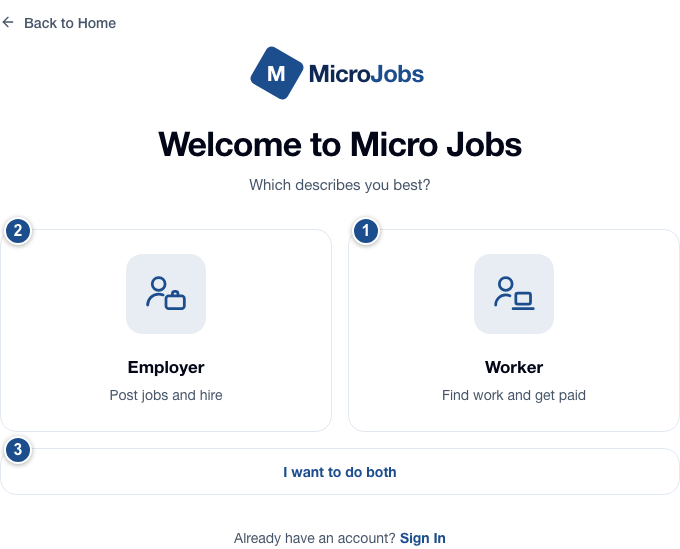

*Figure 1. Marker 1: Worker; marker 2: Employer; marker 3: both roles.*

| Step | Action | Expected result |
| --- | --- | --- |
| 1 | Open Sign Up and choose the role matching your needs. | The account-details form opens. |
| 2 | Check the selected-role description. | You can confirm whether you are registering to work, hire, or both. |
| 3 | Continue with your name and contact details. | The selected role remains associated with the registration. |

### 13.2 Complete registration

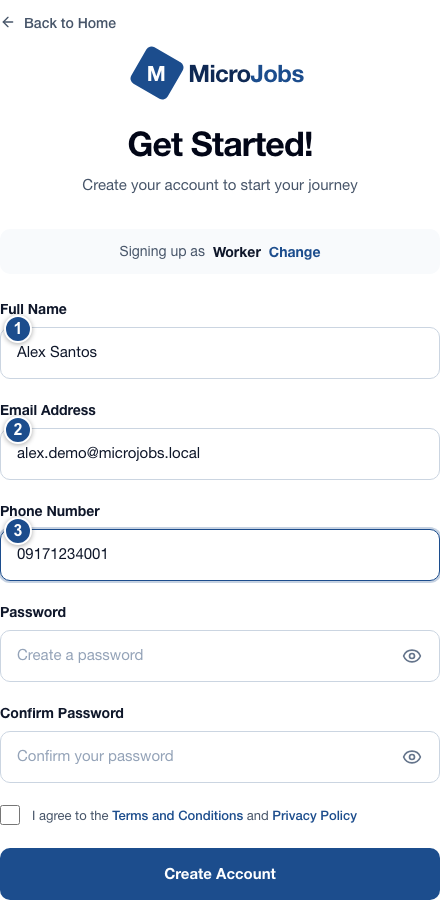

*Figure 2. Marker 1: full name; marker 2: email; marker 3: Philippine phone number. Continue below these fields for passwords and agreement.*

| Step | Action | Expected result |
| --- | --- | --- |
| 1 | Enter your own full name, email, and phone number. | The required contact fields are completed. |
| 2 | Create and confirm a strong password; review and accept the agreement. | The password rules and required agreement are satisfied. |
| 3 | Select Create Account and complete email verification. | The system validates the details and activates the verified account. |

### 13.3 Sign in

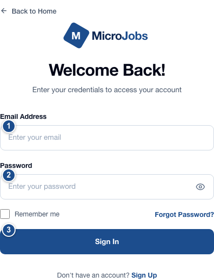

*Figure 3. Marker 1: email; marker 2: password; marker 3: Sign In.*

| Step | Action | Expected result |
| --- | --- | --- |
| 1 | Enter your account email and password. | The fields contain the credentials for your account. |
| 2 | Select Sign In. | A required challenge or an input error appears. |
| 3 | Complete the verification challenge shown by the system. | An authorized session opens the appropriate account view. |

### 13.4 Build and verify your profile

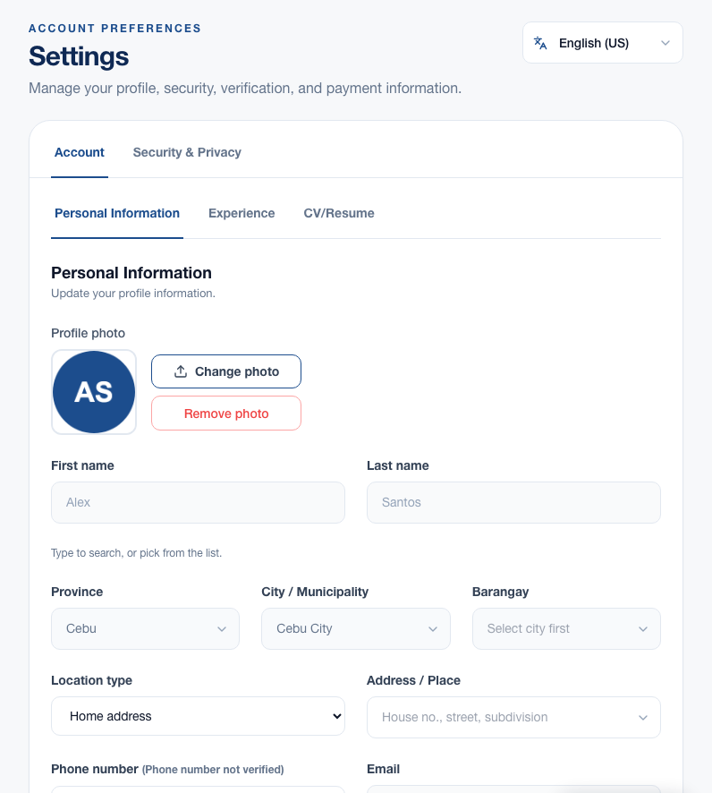

*Figure 4. Account settings in the demonstration worker view.*

| Step | Action | Expected result |
| --- | --- | --- |
| 1 | Open Settings and select Account. | Editable account/profile controls are shown. |
| 2 | Upload and save a profile photo. | The photo prerequisite for applying or posting is met. |
| 3 | Add your skills, experience, and relevant contact/location information. | Saved information appears in your profile and supports recommendations. |

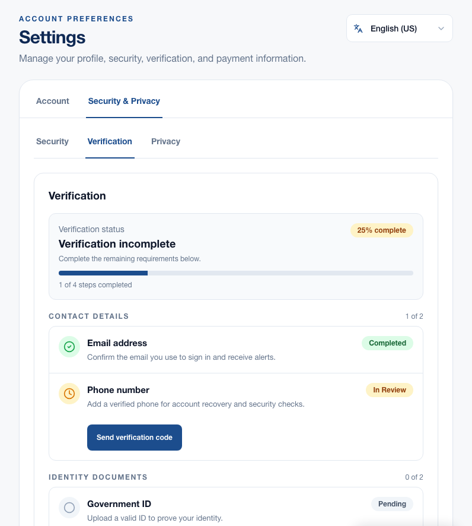

*Figure 5. Verification lists the checks and their actual current states. The example account has incomplete checks.*

| Step | Action | Expected result |
| --- | --- | --- |
| 1 | Open Security & Privacy → Verification. | Email, phone, government ID, and address checks appear. |
| 2 | Complete the available code or document actions. | Each check becomes complete or enters review as appropriate. |
| 3 | Correct rejected information and submit again. | A replacement can be reviewed; the seal appears only after all four checks are complete. |

### 13.5 Use the sidebar and phone navigation

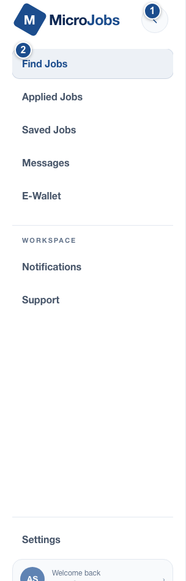

*Figure 6. Marker 1: hide sidebar; marker 2: Find Jobs navigation link.*

| Step | Action | Expected result |
| --- | --- | --- |
| 1 | Select the round chevron at marker 1. | The sidebar slides away completely. |
| 2 | On Find Jobs, use the menu beside Job search. | The full sidebar reopens. |
| 3 | Choose the required page link, such as marker 2. | That page opens and the active link is highlighted. |

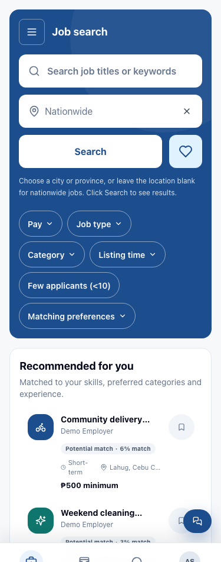

*Figure 7. Phone inputs stack and the primary actions remain together.*

| Step | Action | Expected result |
| --- | --- | --- |
| 1 | Open Find Jobs on a phone. | The search controls fit the narrow screen. |
| 2 | Use the menu to open navigation. | A drawer shows the available page links. |
| 3 | Select a page or close the drawer. | Navigation completes or focus returns to the opener. |

### 13.6 Search, filter, and save jobs

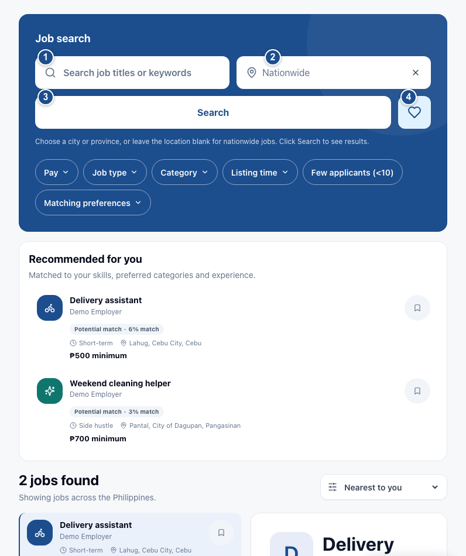

*Figure 8. Marker 1: keyword; marker 2: location; marker 3: Search; marker 4: Saved Jobs.*

| Step | Action | Expected result |
| --- | --- | --- |
| 1 | Type a job title or keyword at marker 1. | A draft is prepared; the existing results remain. |
| 2 | Select/type a city or province at marker 2, or leave it blank. | A selected-location or nationwide draft is prepared. |
| 3 | Select Search at marker 3 or press Enter. | Both fields apply together while filters remain selected. |
| 4 | Use a job's heart to save it, then open marker 4. | The saved listing is available through Saved Jobs after sign-in. |

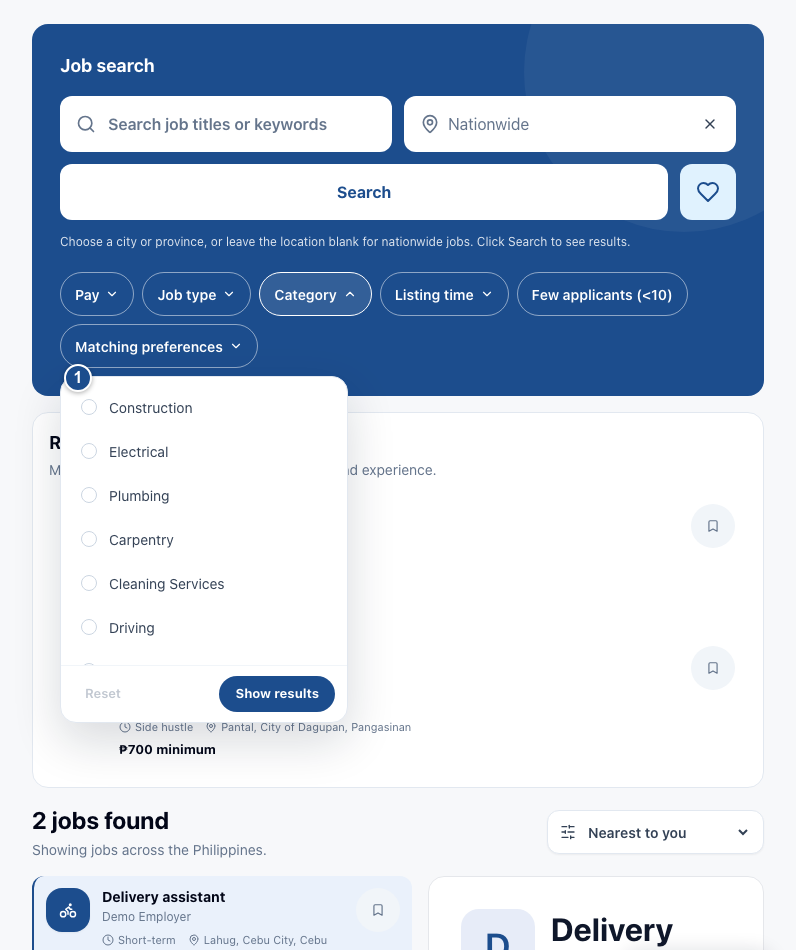

*Figure 9. The white dropdown extends beyond the search band.*

| Step | Action | Expected result |
| --- | --- | --- |
| 1 | Open the desired filter pill. | Its choices appear in a readable menu. |
| 2 | Select a choice and use Show results where provided. | The filter applies and its active count updates. |
| 3 | Use Reset or Clear all as needed. | Appropriate filters clear while search drafts are retained. |

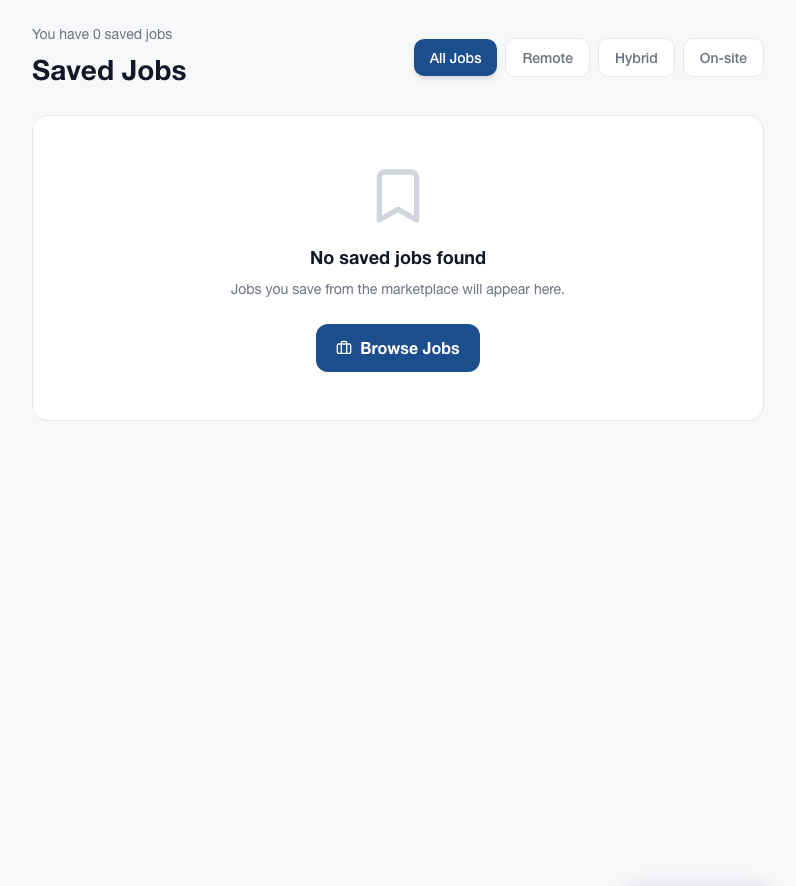

*Figure 10. An account with no saved listings shows an explicit empty state; saving a listing supplies content for this page.*

### 13.7 Read a job and apply

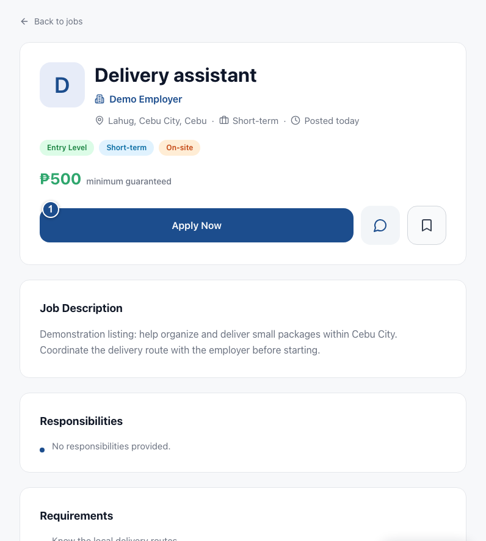

*Figure 11. Read the job information before using Apply Now at marker 1.*

| Step | Action | Expected result |
| --- | --- | --- |
| 1 | Open a search result and review the pay, place, deadline, and requirements. | You can assess the opportunity before applying. |
| 2 | Confirm that your profile photo is saved. | The profile prerequisite is met. |
| 3 | Select Apply Now once. | A successful application appears in Applied Jobs; duplicate/own-job applications are blocked. |

### 13.8 Respond to an offer and submit finished work

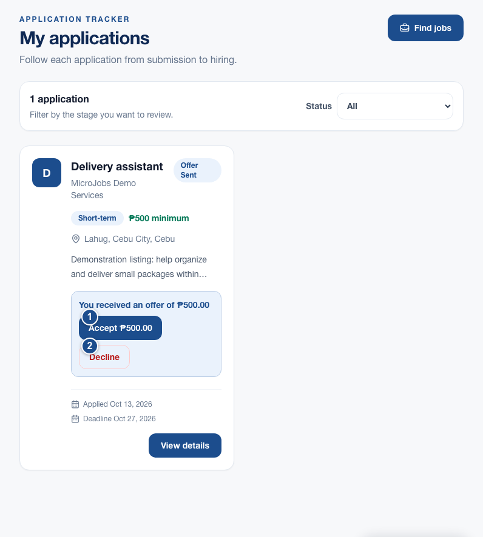

*Figure 12. Marker 1: accept the displayed amount; marker 2: decline.*

| Step | Action | Expected result |
| --- | --- | --- |
| 1 | Open the offer in Applied Jobs and read the job and amount. | The proposed terms are visible. |
| 2 | Accept or decline, then complete the confirmation. | Your response is recorded. |
| 3 | After acceptance, wait for employer confirmation. | Confirmed hiring changes the application to Hired. |

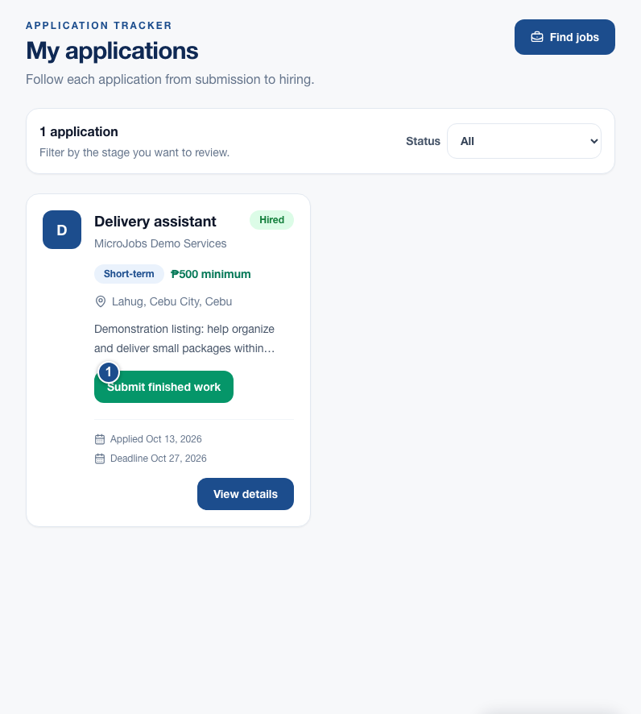

*Figure 13. Marker 1: Submit finished work for a hired application.*

| Step | Action | Expected result |
| --- | --- | --- |
| 1 | Finish the agreed work and open the hired application. | Submission is available in an eligible work state. |
| 2 | Select Submit finished work. | Work becomes Submitted and the employer is notified. |
| 3 | Review any changes requested, revise, and submit again if necessary. | After settlement, the work is completed/paid and the worker balance is credited. |

### 13.9 Post a job through the four-stage wizard

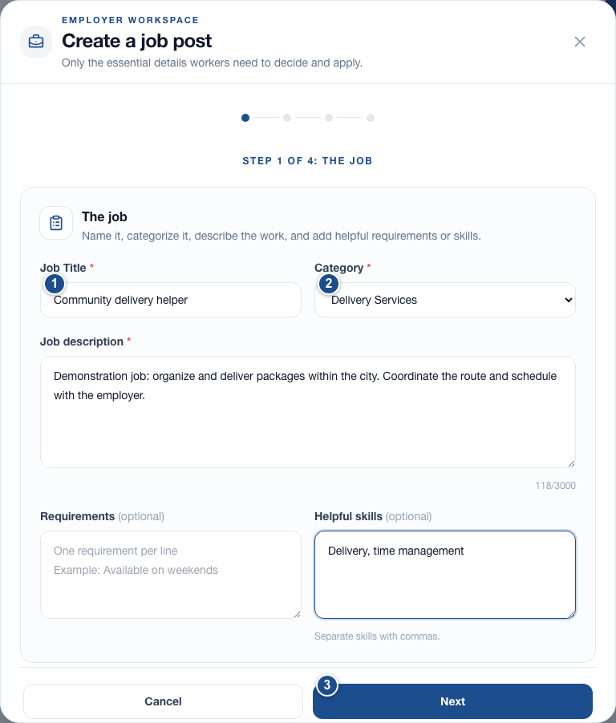

*Figure 14. Marker 1: title; marker 2: category; marker 3: Next.*

| Step | Action | Expected result |
| --- | --- | --- |
| 1 | Open the employer Post a Job page, then select its posting action. | The creation wizard opens at Job. |
| 2 | Enter a title, category, description, and optional skills/requirements. | Required job-content fields are ready. |
| 3 | Select Next. | Valid fields allow Where & when to open. |

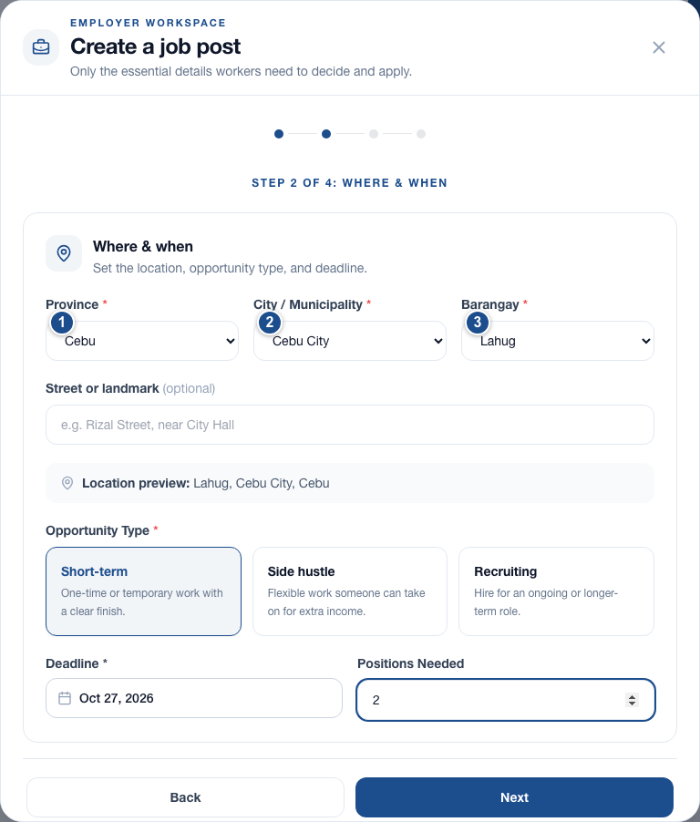

*Figure 15. Marker 1: province; marker 2: city; marker 3: barangay. Continue within the wizard for type, deadline, and worker count.*

| Step | Action | Expected result |
| --- | --- | --- |
| 4 | Select the province, city, and barangay; add an address if needed. | The location preview reflects the selected place. |
| 5 | Select the opportunity type, deadline, and number of workers. | Location and scheduling requirements are complete. |
| 6 | Select Next. | The Pay stage opens, or missing-field validation asks for corrections. |

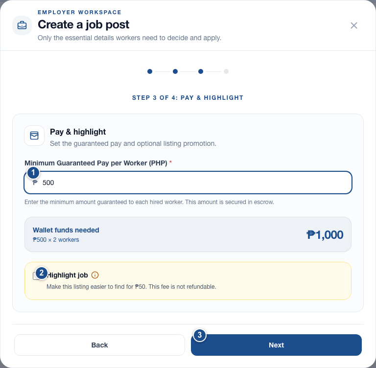

*Figure 16. Marker 1: pay per worker; marker 2: optional highlight; marker 3: Next.*

| Step | Action | Expected result |
| --- | --- | --- |
| 7 | Enter positive minimum guaranteed pay per worker. | Secured worker pay recalculates using the worker count. |
| 8 | Review the optional highlight and its separate fee. | Your chosen promotion is reflected in the charges. |
| 9 | Select Next. | Review opens with the entered values. |

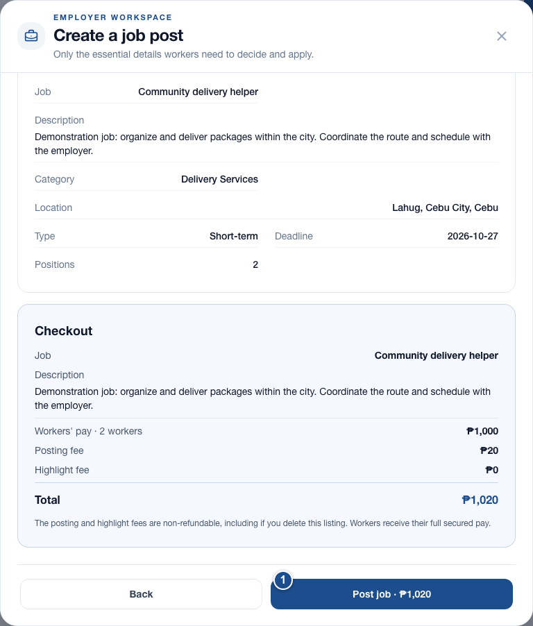

*Figure 17. Marker 1: priced posting action. Example: PHP 500 × two workers + PHP 20 = PHP 1,020 without highlighting.*

| Step | Action | Expected result |
| --- | --- | --- |
| 10 | Check the content, location, worker count, and itemized total. | You can confirm what will be posted and funded. |
| 11 | Use Back to correct a value, or select the priced posting action. | The server checks the listing and available funds. |
| 12 | Review the returned listing and wallet history. | A successful job is stored and funded; insufficient funds require a top-up. |

### 13.10 Review applications as an employer

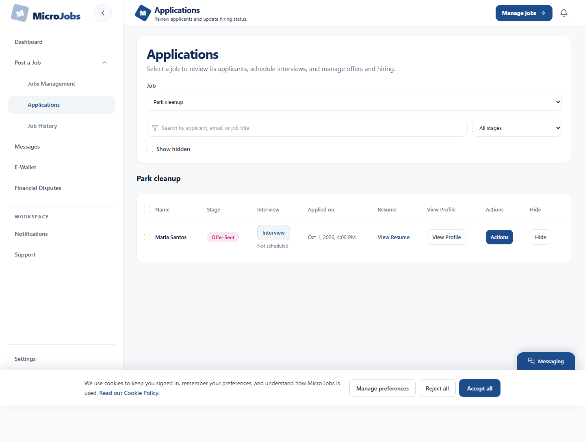

*Figure 18. Employer application table for the sample Park cleanup job, showing an accepted offer. The table scrolls horizontally on narrow screens.*

| Step | Action | Expected result |
| --- | --- | --- |
| 1 | Open Applications and select a posted job. | Only that job's title and applicant table are displayed. |
| 2 | Open a row's Actions dialog; change status or send and confirm a formal offer. | The dialog moves to applicant review after the offer is sent. |
| 3 | After acceptance, review the highlighted warning and choose Hire or Reject. | Confirmed hiring moves to payment; rejection cancels the offer before rejecting the application. |
| 4 | Authorize payment, then review submitted work, request changes, or approve and pay. | Authorization keeps funds secured; settlement credits that worker's balance. |

### 13.11 Use messages and view another profile

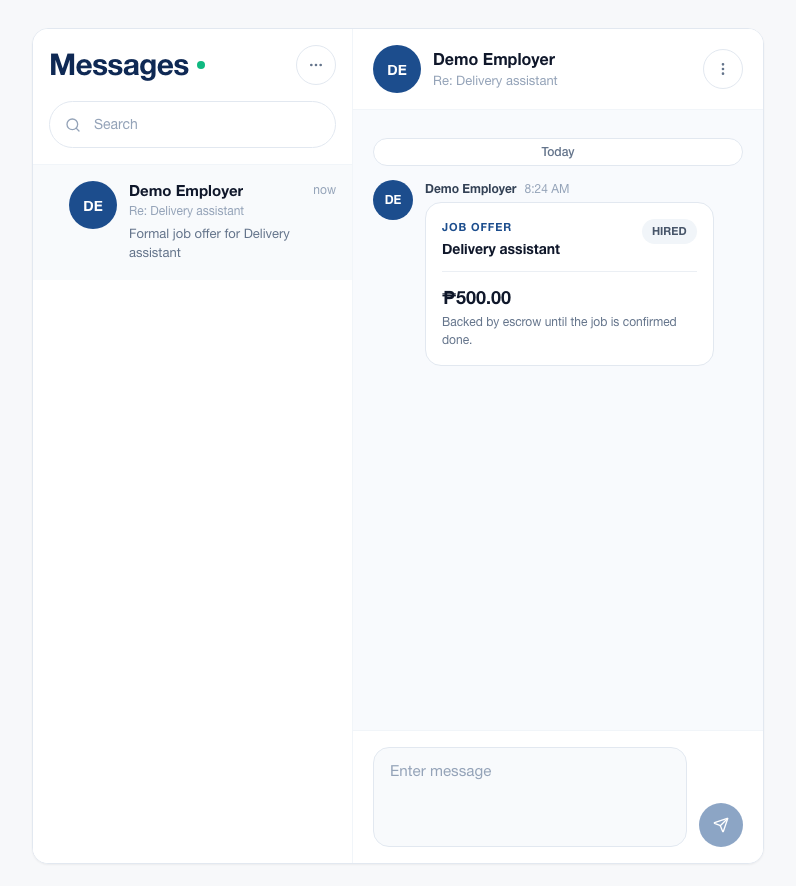

*Figure 19. Conversation header and messages for the demonstration delivery job.*

| Step | Action | Expected result |
| --- | --- | --- |
| 1 | Open Messages and select the relevant conversation. | The participant and job context appear. |
| 2 | Type and send a message. | The conversation records it. |
| 3 | Select the other participant's name or avatar in the header. | Their profile opens; staff support participants omit this shortcut. |

### 13.12 Check earnings and request a withdrawal

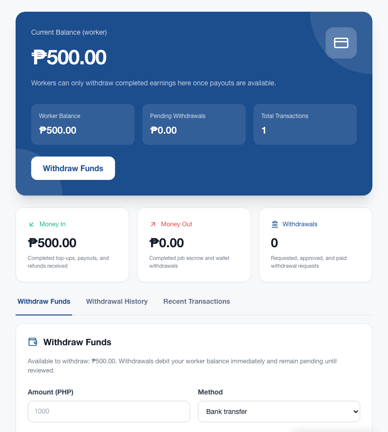

*Figure 20. The demonstration account received a PHP 500 job settlement into its worker balance.*

| Step | Action | Expected result |
| --- | --- | --- |
| 1 | Open E-Wallet in the worker view. | Available worker funds appear separately from employer funds. |
| 2 | Inspect Transactions and the relevant reference/status. | You can confirm the recorded settlement amount. |
| 3 | Enter the withdrawal amount and destination, submit, and inspect Withdrawal History. | A separate withdrawal request records its review/payment state. |

### 13.13 Ask for support

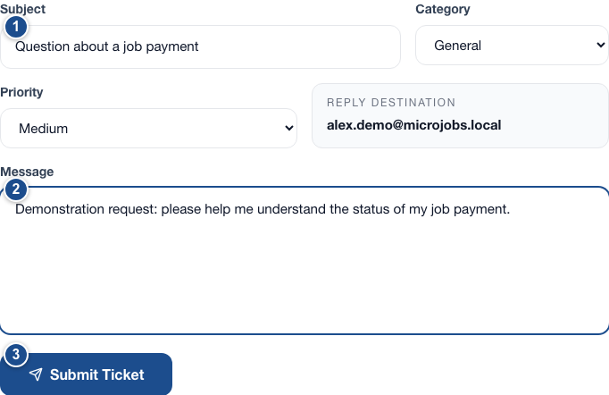

*Figure 21. Ticket form: marker 1 is the subject, marker 2 is the description, and marker 3 submits the ticket.*

| Step | Action | Expected result |
| --- | --- | --- |
| 1 | Open Support and select the ticket-creation action. | The support form becomes available. |
| 2 | Enter a clear subject, category, description, and relevant record reference. | Staff have enough context to investigate. |
| 3 | Submit and follow the ticket; reply when staff request information. | The ticket and its replies can be tracked. |

### 13.14 Review a payout as authorized staff

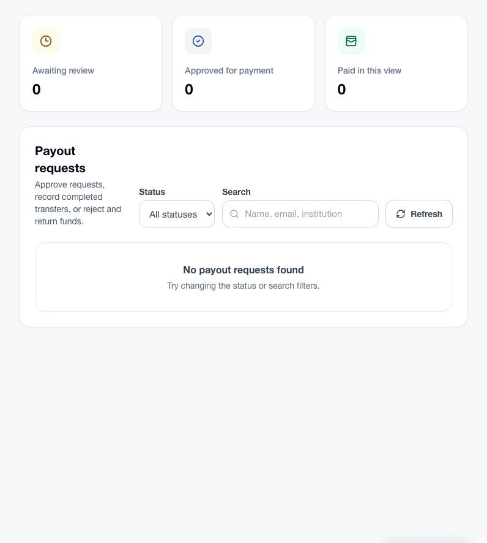

*Figure 22. The demonstration queue is empty. The screenshot starts with an already authorized staff session.*

| Step | Action | Expected result |
| --- | --- | --- |
| 1 | Open Payouts with an authorized staff session. | The permission-controlled queue appears. |
| 2 | Select an available request and check amount, destination, and state. | The record provides the information needed for a decision. |
| 3 | Perform an allowed review action and inspect the result. | Approval and marking paid remain distinct; an empty queue has no request to approve. |

### 13.15 Recognize the landing-page feature cards

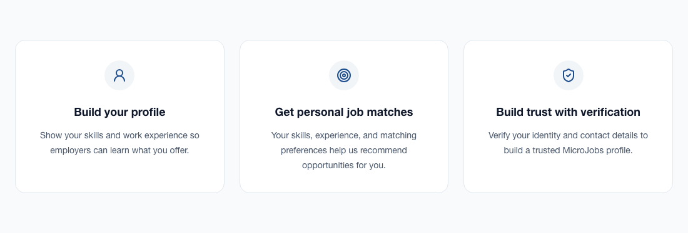

*Figure 23. Build your profile, Get personal job matches, and Build trust with verification belong to the landing page.*

These cards explain platform features. To carry out the tasks, use the profile, preferences, and verification procedures above. They are informational cards rather than proof that the demonstration account is fully verified.
